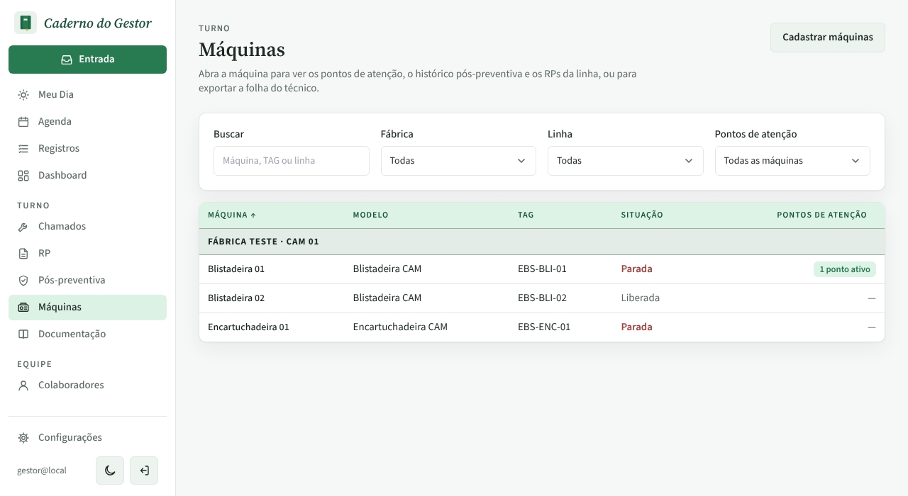
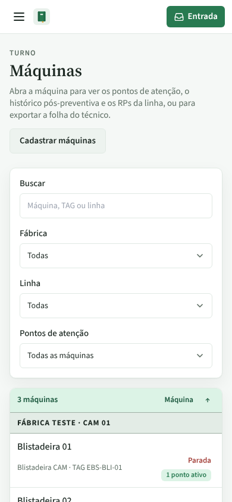
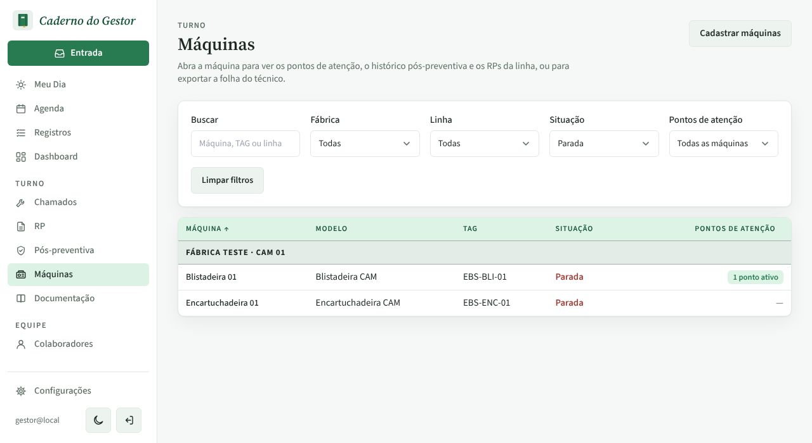
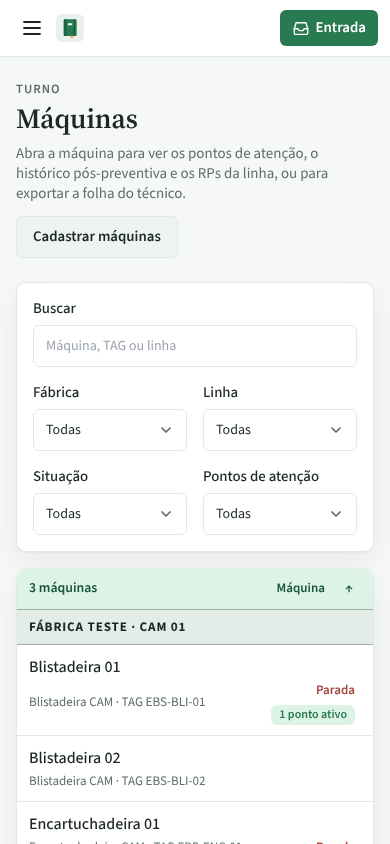
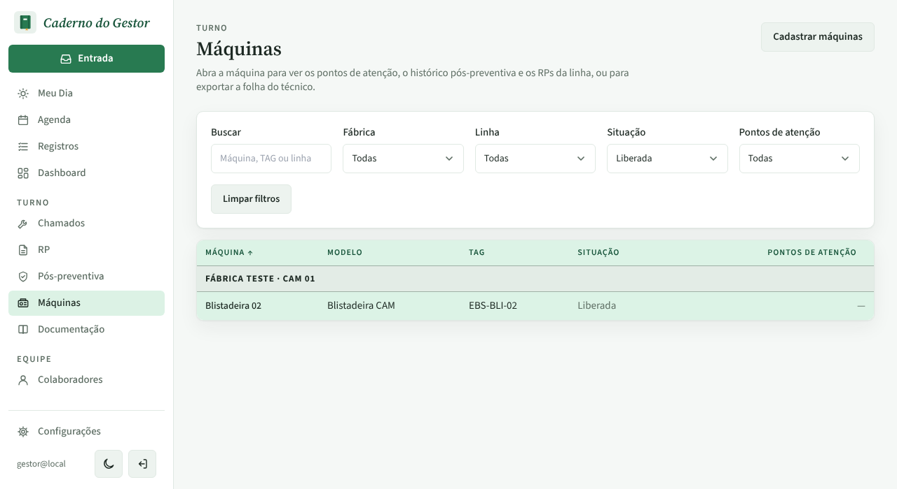

# PR #100: Máquinas, filtro de situação na lista

Antes: a lista não tinha filtro de situação; as paradas ficavam misturadas com as liberadas. No celular, os 4 filtros ficavam um por fileira.

Depois: filtro Situação (aqui em Parada) e, no celular, dois filtros por fileira.

