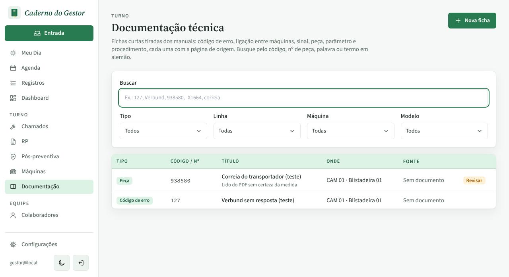
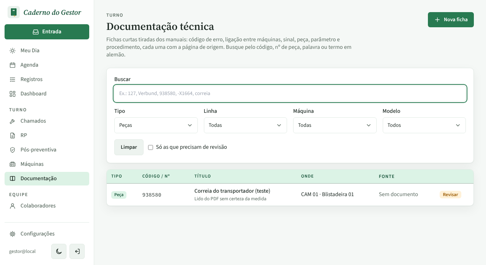
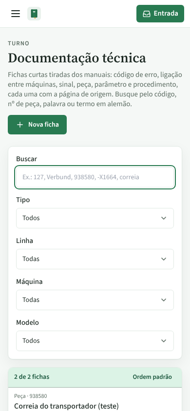
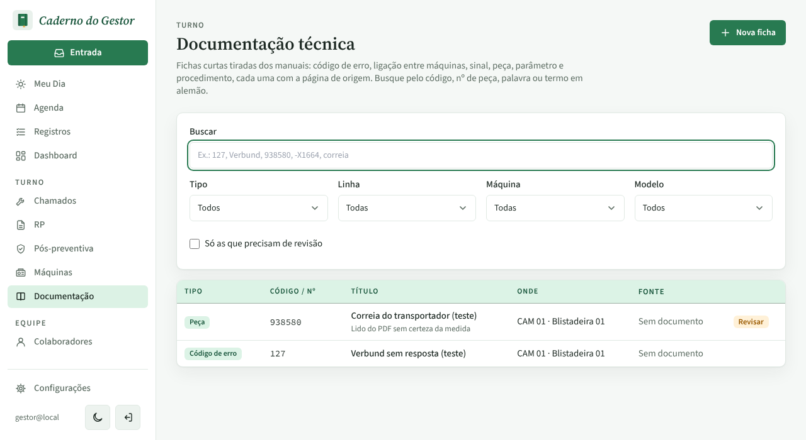
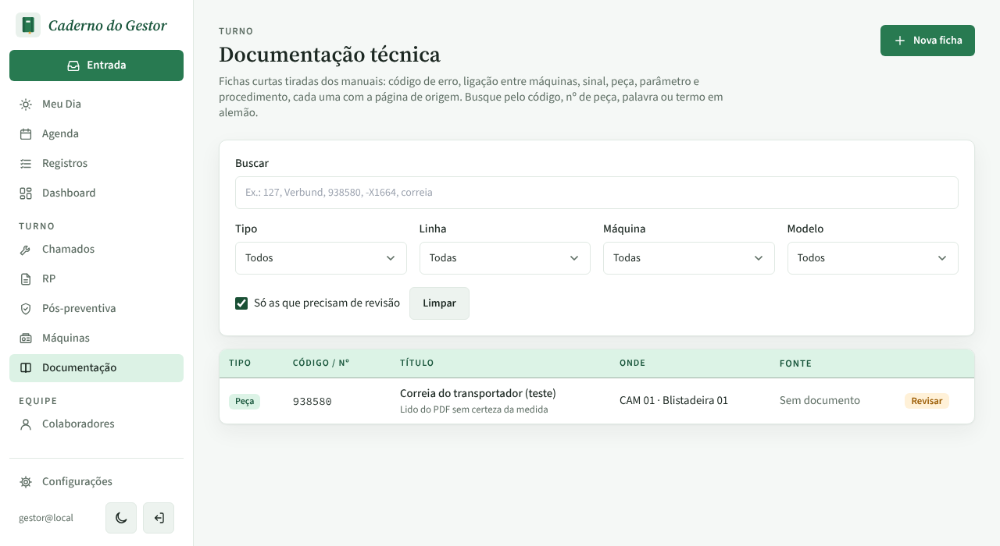
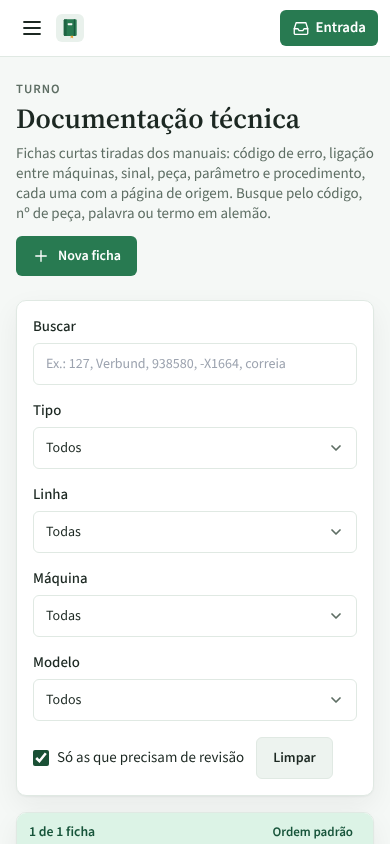
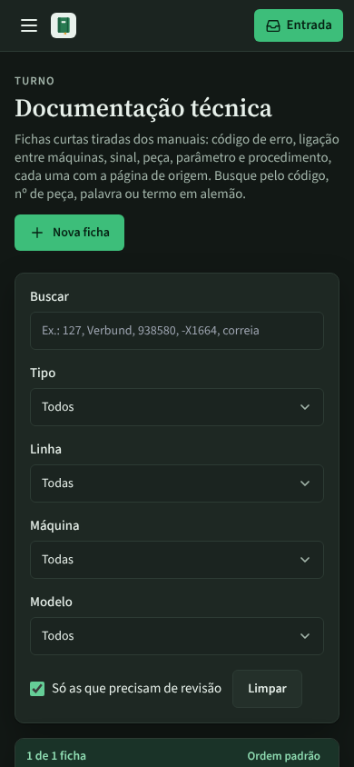

# PR #101: Documentação, filtro de revisão à vista na tela limpa

Antes: na tela recém-aberta não havia a caixa "Só as que precisam de revisão". Ela só aparecia depois de escolher outro filtro (aqui, Tipo = Peças).

Depois: a caixa está sempre à vista. Marcada, a lista mostra só a ficha a revisar (1 de 1) e o "Limpar" aparece ao lado.

