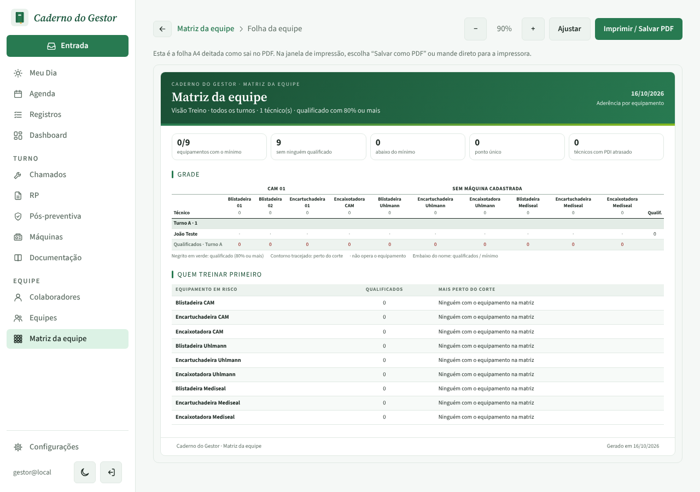
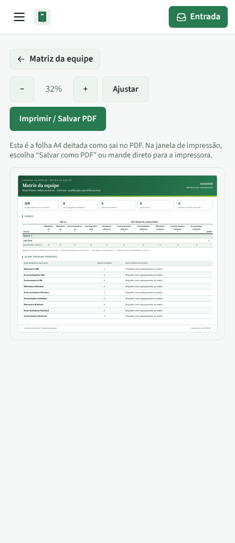

# PR #105: team sheet technician count

The subtitle of the team matrix A4 sheet (`/competencias/folha`) read "1 técnico(s)". It now reads "1 técnico", and "N técnicos" otherwise. The Excel tab uses the same text.

Same local data in every shot: one active technician (João Teste), light theme.

## Sheet header, zoomed

| Before | After |
| --- | --- |
|  |  |

## Desktop (1280 px)

| Before | After |
| --- | --- |
|  |  |

## Mobile (390 px)

At 390 px the A4 preview is scaled down to fit, so the text is too small to read here; the zoomed header above shows it.

| Before | After |
| --- | --- |
|  |  |
