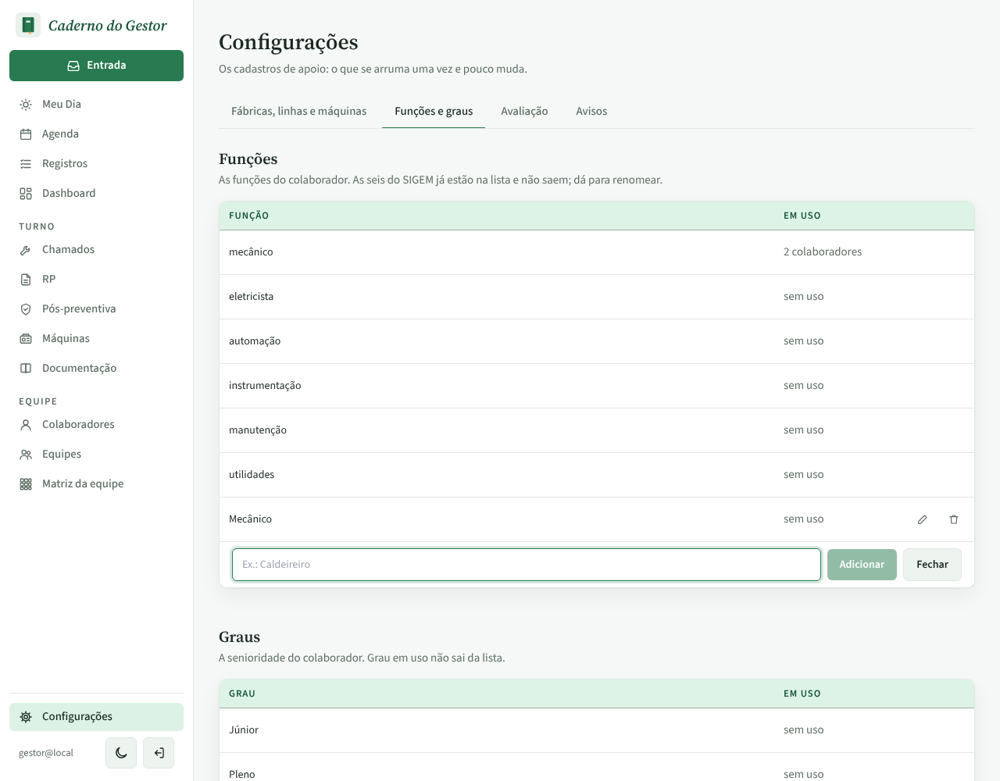
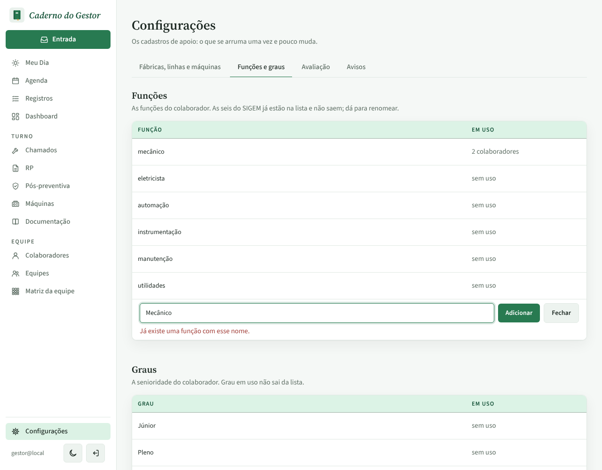
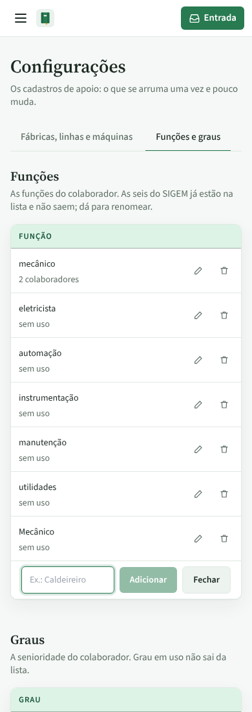
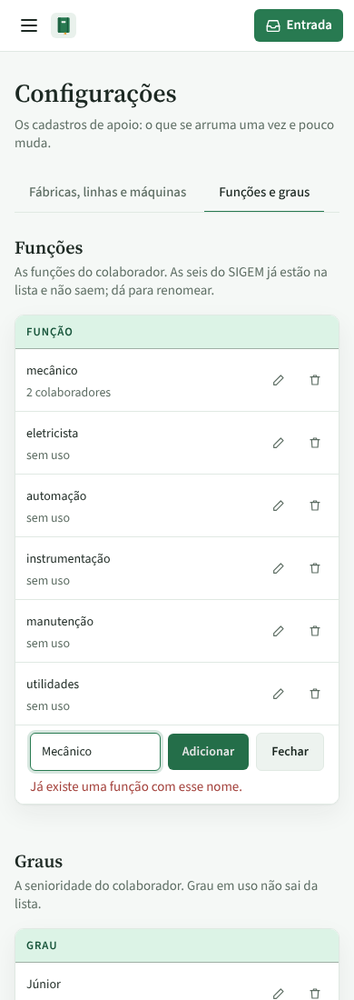

# PR #106: duplicate role names with different case

Settings → Funções e graus, typing "Mecânico" in "Adicionar função" while "mecânico" already exists.

Before: the new role is saved, and the list shows both "mecânico" and "Mecânico".
After: the API answers "Já existe uma função com esse nome." and the list stays as it was. Grades behave the same way.

## Desktop (1280 px)

| Before | After |
| --- | --- |
|  |  |

## Mobile (390 px)

| Before | After |
| --- | --- |
|  |  |
