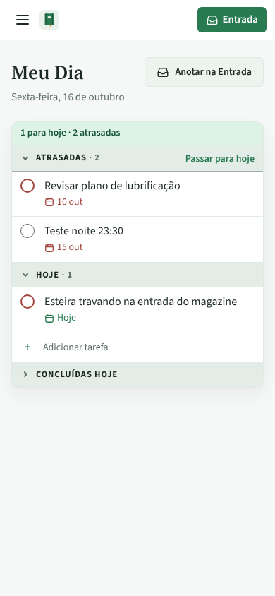
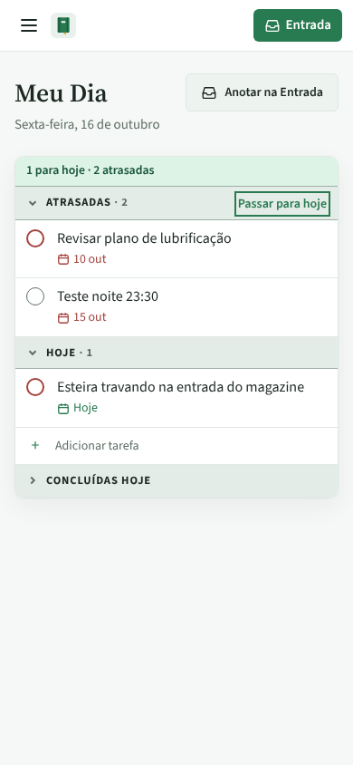
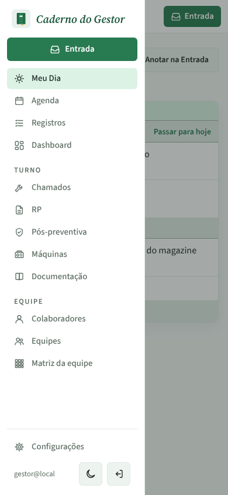
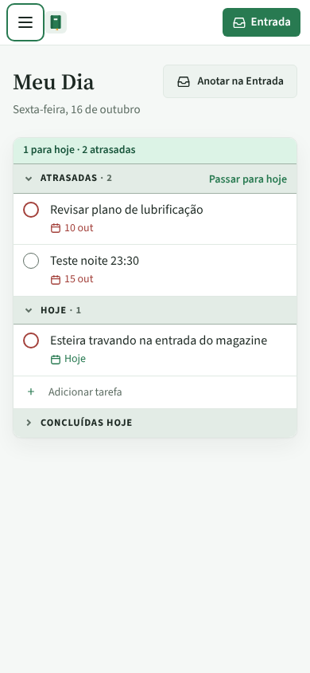

# PR #107: mobile menu and the keyboard

Narrow screen (390 px), Meu Dia, using a keyboard (tablet or phone with a keyboard, or a narrow desktop window).

## Tab five times from the top of the page

Before: the five stops are Entrada, Meu Dia, Agenda, Registros and Dashboard inside the closed menu, which is off screen, so nothing on the page shows focus (17 hidden stops in total).
After: Tab goes to "Abrir menu", Entrada, "Anotar na Entrada", Atrasadas and "Passar para hoje", all visible; the fifth one has the focus ring.

| Before | After |
| --- | --- |
|  |  |

## Open the menu, press Esc

Before: the menu stays open. After: it closes and focus goes back to "Abrir menu".

| Before | After |
| --- | --- |
|  |  |

Desktop (1280 px) does not change: the sidebar is always visible and Tab starts at Entrada, as before.
