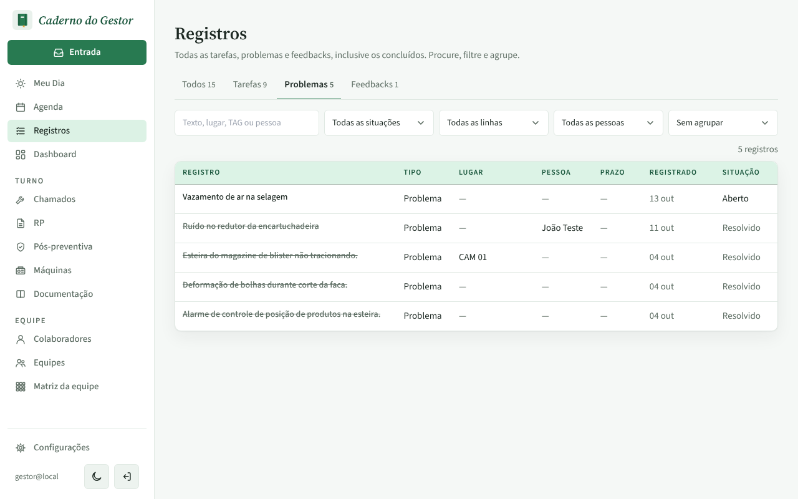
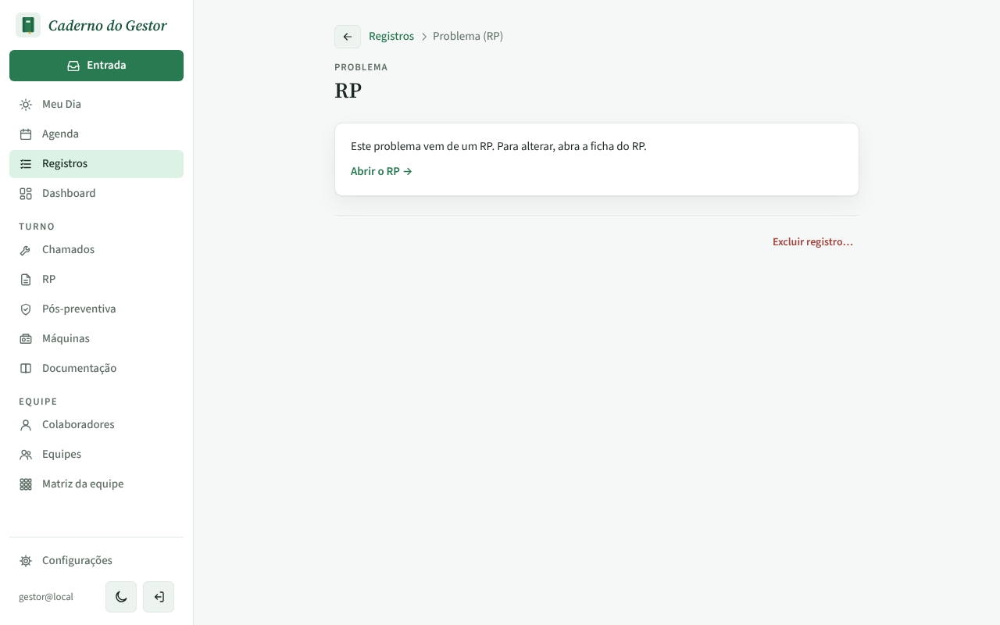
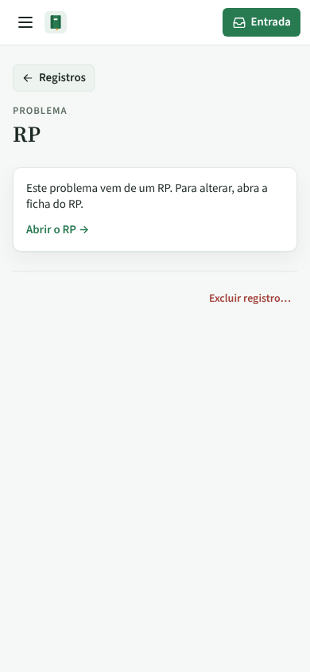
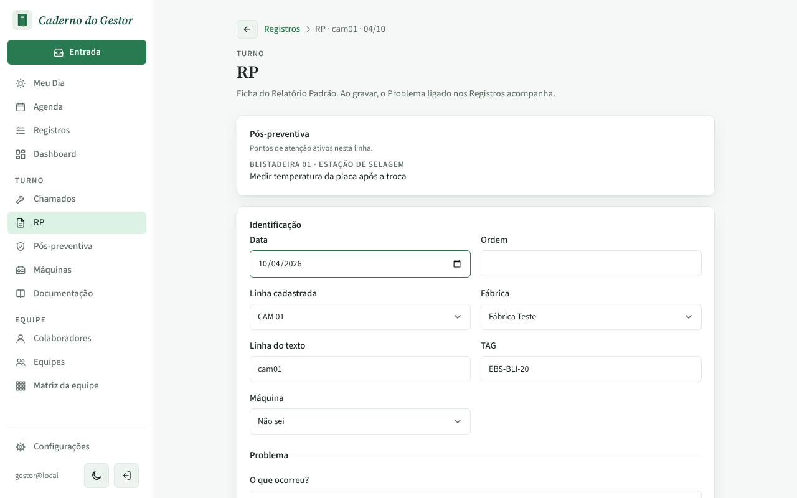
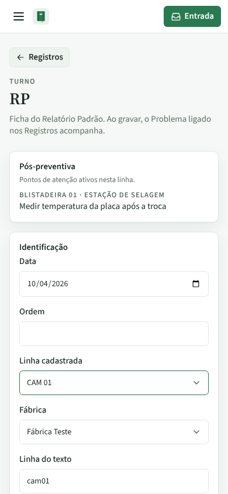

# PR #108: open the RP sheet straight from an RP problem

Local app with the disposable database, `gestor@local`. Registros > Problemas, "Todas as situações", click "Esteira do magazine de blister não tracionando." (a problem created by an RP).

## The list

## Before: a page titled "RP" without the problem, only "Abrir o RP"

| Desktop | Mobile |
|---|---|
|  |  |

## After: the RP sheet opens directly

The RP sheet no longer shows "Ver o Problema nos Registros", which would now lead back to itself. The browser Back button returns to the filtered Registros list (`/registros?tipo=problemas&situacao=todos`) on both sizes.

| Desktop | Mobile |
|---|---|
|  |  |
