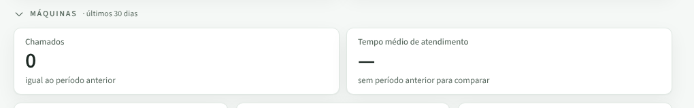
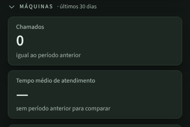
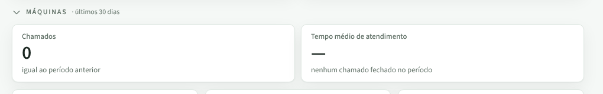
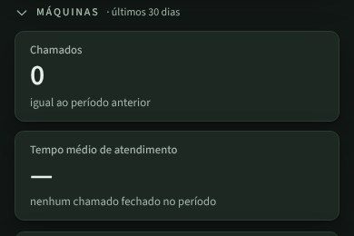
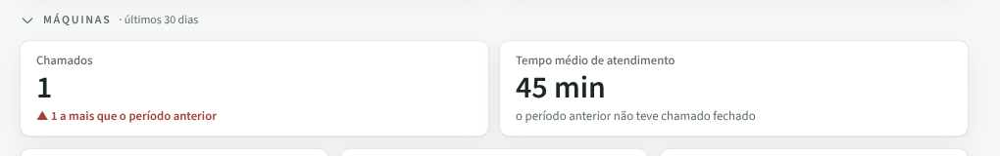

# PR #113: say no closed chamado when dashboard average time is empty

Local app with the disposable database, `gestor@local`. Dashboard, period "30 dias", Máquinas band.

## Before: no closed chamado, and the card blames the previous period

| Desktop | Mobile (dark) |
|---|---|
|  |  |

## After: the card says what is missing

| Desktop | Mobile (dark) |
|---|---|
|  |  |

With one chamado closed yesterday (45 min) and none in the previous 30 days:

Full pages: [before](before-full-desktop.png), [after](after-full-desktop.png).
