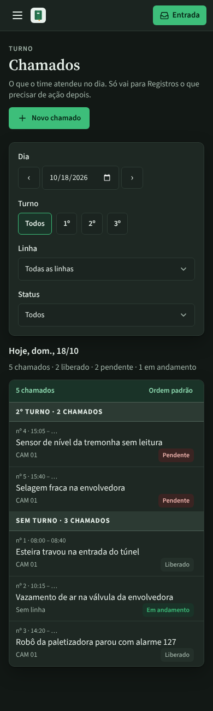
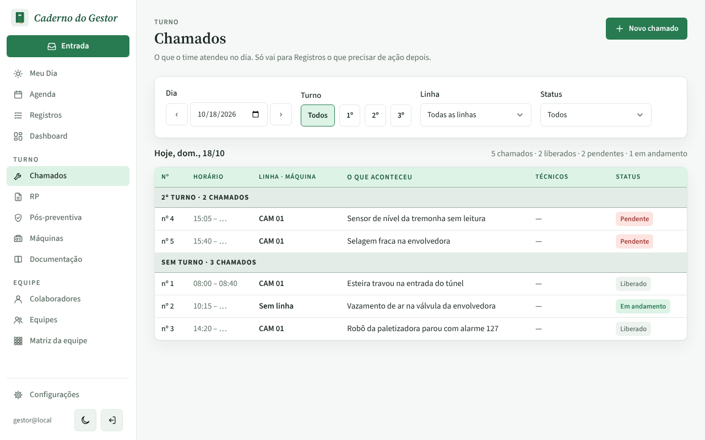
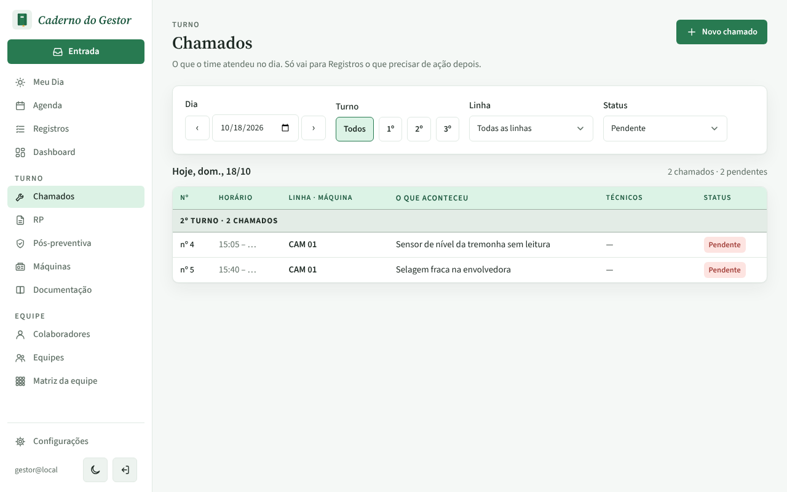

# PR #115: pluralize status counts in the chamados day summary

Local app with the disposable database, `gestor@local`. Turno > Chamados, today, five chamados: two liberados, two pendentes, one em andamento. Look at the line next to "Hoje, dom., 18/10".

## Before: "2 liberado · 2 pendente"

| Desktop | Mobile (dark) |
|---|---|
|  |  |

## After: "2 liberados · 2 pendentes · 1 em andamento"

| Desktop | Mobile (dark) |
|---|---|
|  |  |

With the Status filter on "Pendente": "2 chamados · 2 pendentes".

