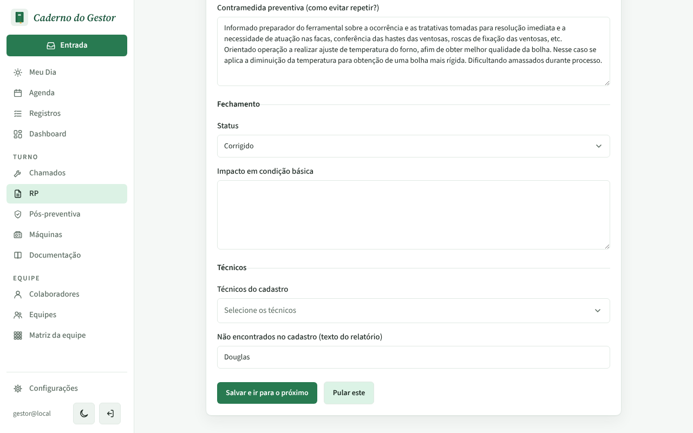
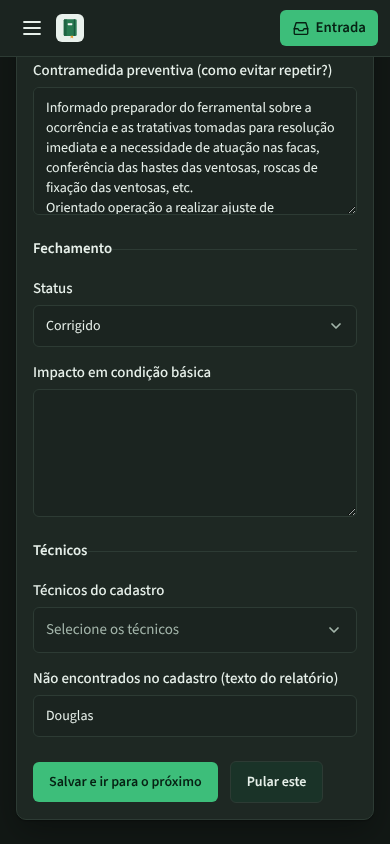
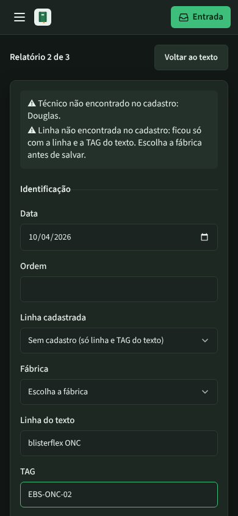
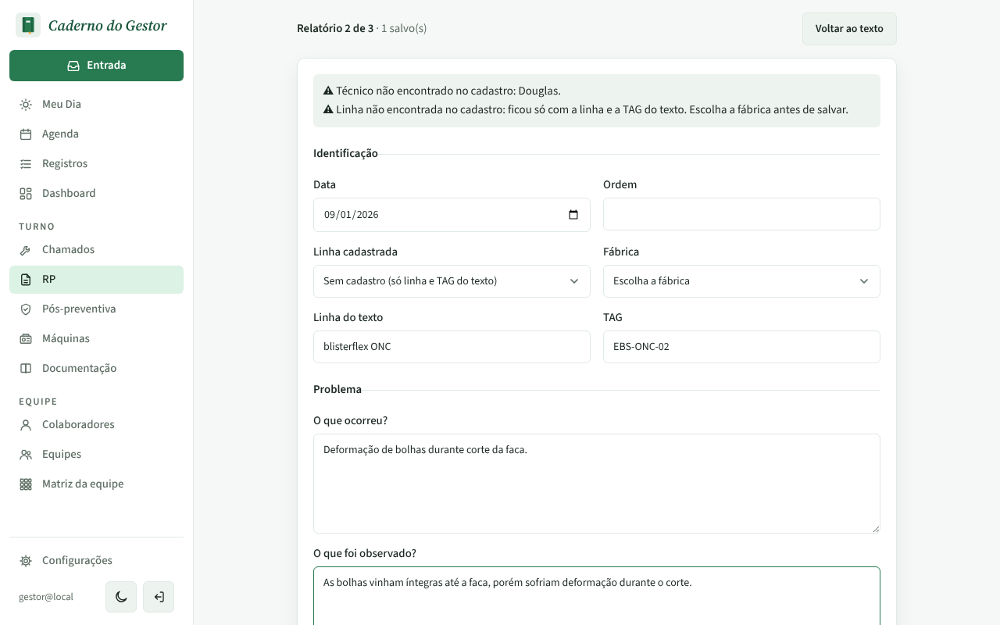

# PR #120: open the next pasted rp at the top of its sheet

Local app with the disposable database, `gestor@local`. RP > Colar RP, paste three reports at once (the API's `rp1.txt`, `rp2.txt` and `rp3.txt` fixtures), Interpretar, then go to the second report. The prints show the screen as it opens, without scrolling.

## Before: "Pular este" opens report 2 at the bottom of the form

| Desktop | Mobile (dark) |
|---|---|
|  |  |

## After: report 2 opens at "Relatório 2 de 3" with its warnings

| Desktop | Mobile (dark) |
|---|---|
|  |  |

Same after "Salvar e ir para o próximo" (report 1 saved with a factory picked):

