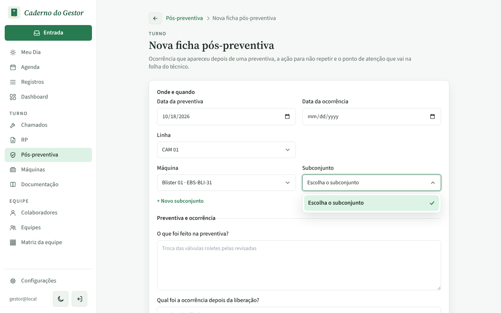
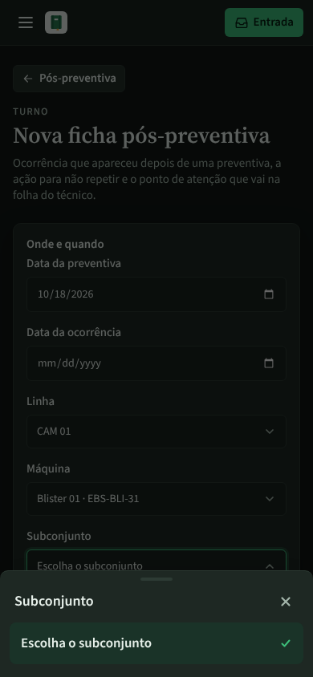
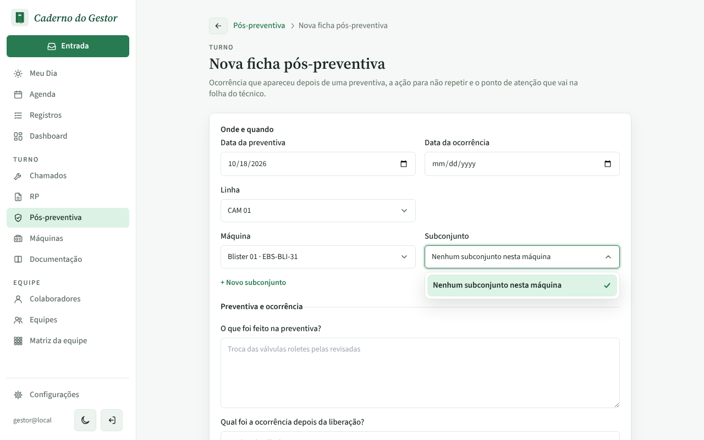
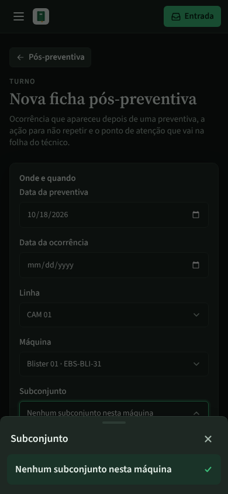
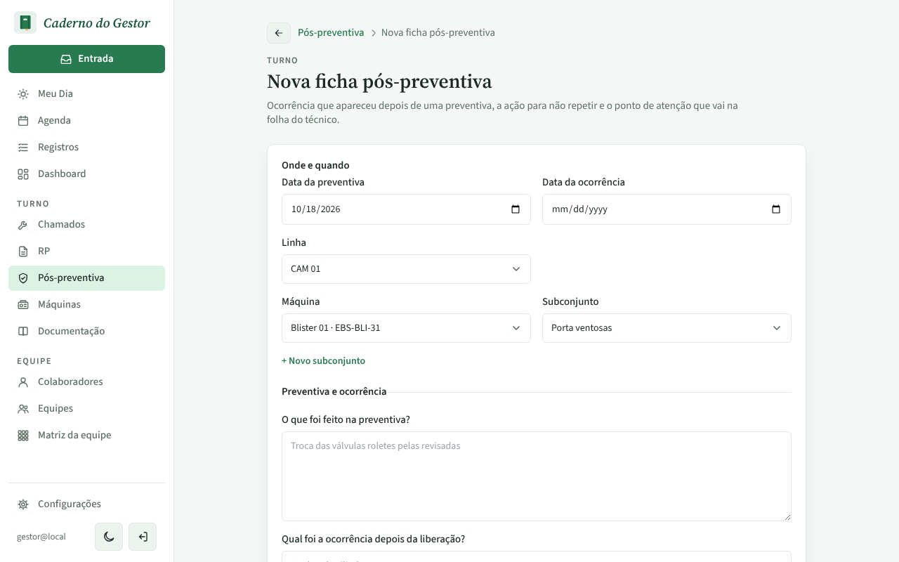

# PR #122: say when a machine has no subassembly to pick

Local app with the disposable database, `gestor@local`. Pós-preventiva > Nova ficha, line CAM 01, machine Blister 01 (model "Blisterflex 500", no subassembly yet), then open Subconjunto.

## Before: only "Escolha o subconjunto", with nothing to choose

| Desktop | Mobile (dark) |
|---|---|
|  |  |

## After: "Nenhum subconjunto nesta máquina"

| Desktop | Mobile (dark) |
|---|---|
|  |  |

After "+ Novo subconjunto" creates "Porta ventosas", the field picks it as before:

