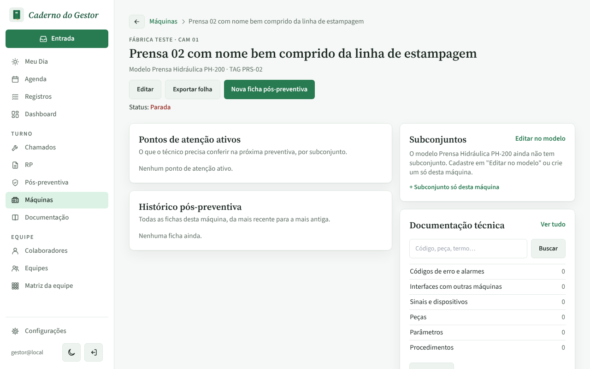
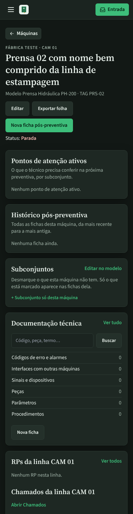
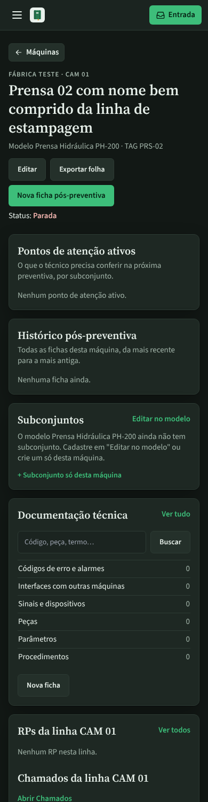

# PR #124: machine page, empty Subconjuntos card

Machine whose model (Prensa Hidráulica PH-200) has no subassembly yet. Before, the card asked to uncheck what the machine lacks, with nothing to uncheck. After, it says the model has no subassembly yet and points to "Editar no modelo" or "+ Subconjunto só desta máquina".

| | Before | After |
|---|---|---|
| Desktop, light |  |  |
| Mobile, dark |  |  |
