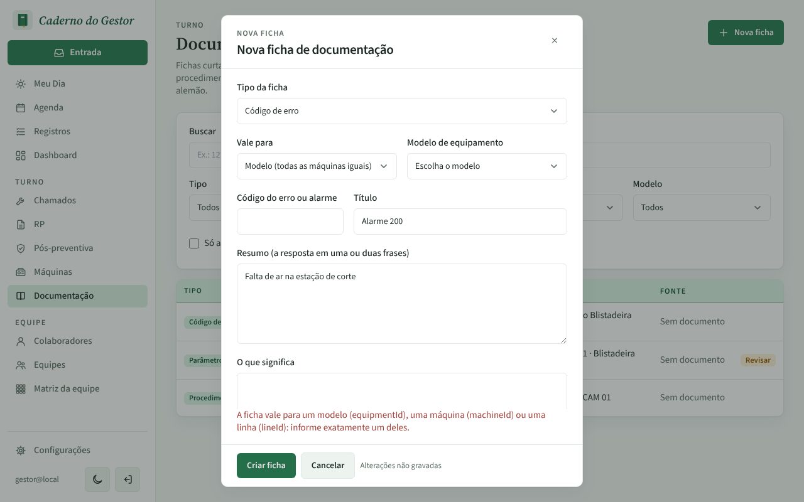
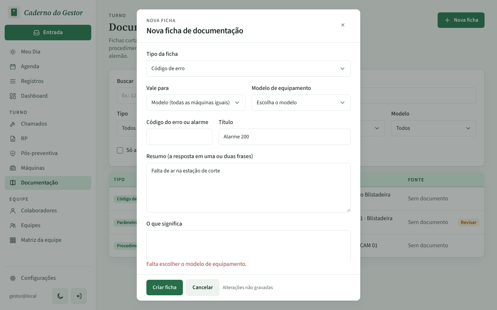
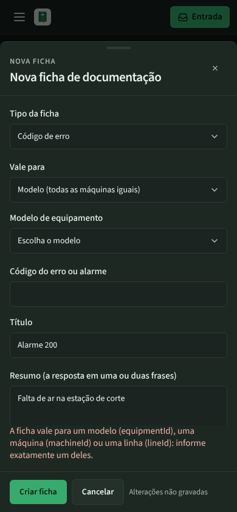
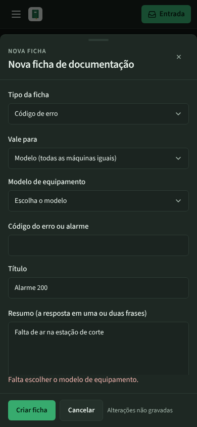

# PR #125: new tech card without a model, machine or line

"Nova ficha" filled with a title and summary, "Vale para" left on Modelo with no model picked, then "Criar ficha". Before, the form showed the API message written for the AI agent ("equipmentId, machineId ou lineId"). After, it says "Falta escolher o modelo de equipamento." and nothing is sent; the notice goes away once the model is picked.

| | Before | After |
|---|---|---|
| Desktop, light |  |  |
| Mobile, dark |  |  |
