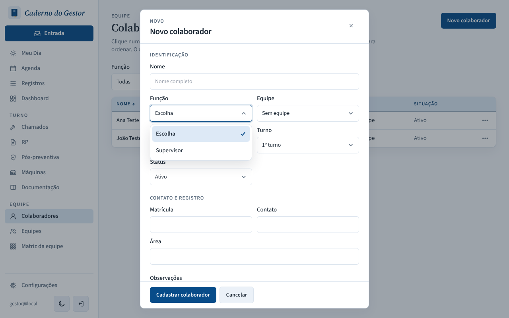
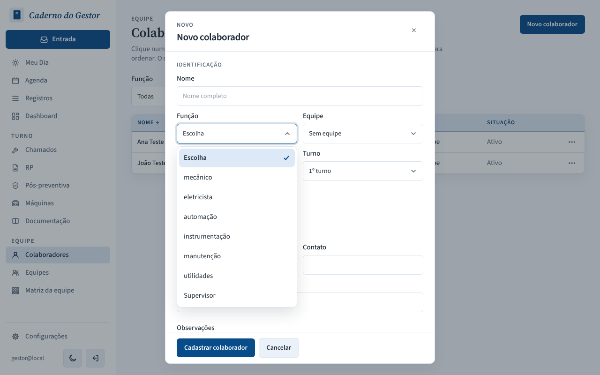

# PR #129: new database only offered Supervisor as a role

Fresh local database, migrations applied, API started, "Novo colaborador" > Função opened. Before, the only role was Supervisor (created by the `20261018200000_role_leads_teams` migration, which made the boot seed skip the six SIGEM roles). After, the six SIGEM roles are created on boot next to Supervisor; a second boot keeps the same 7 roles.

| | Before | After |
|---|---|---|
| Desktop, light |  |  |
| Mobile, dark |  |  |
