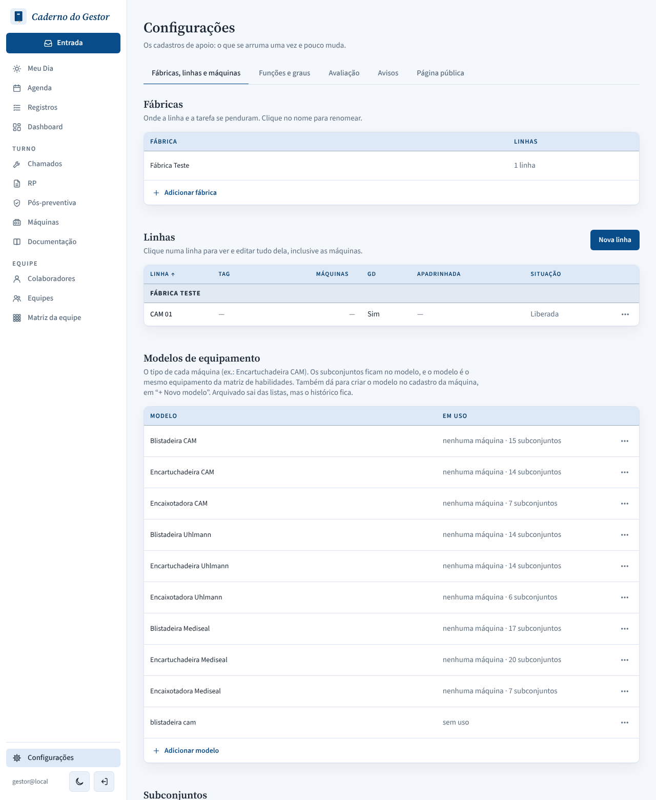
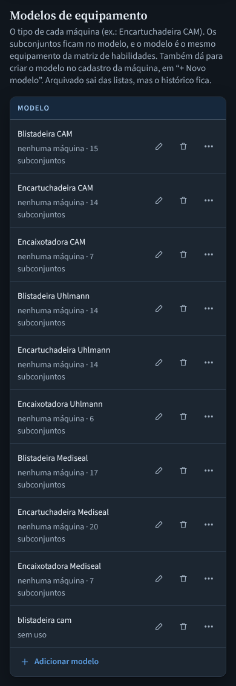
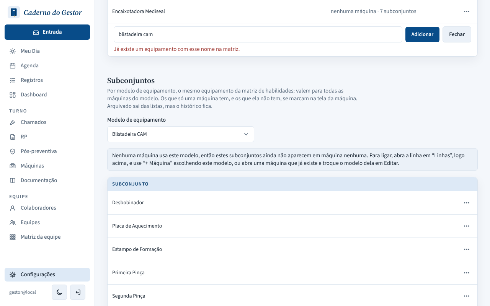
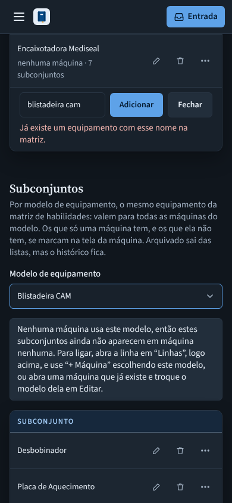

# PR #134: equipment model names that differ only in case

Configurações > Fábricas, linhas e máquinas > Modelos de equipamento, adding "blistadeira cam" while "Blistadeira CAM" already exists. Local app with a throwaway database.

| | Desktop, light | Mobile, dark |
|---|---|---|
| Before: the lowercase copy is saved as a second model |  |  |
| After: refused with "Já existe um equipamento com esse nome na matriz." |  |  |
