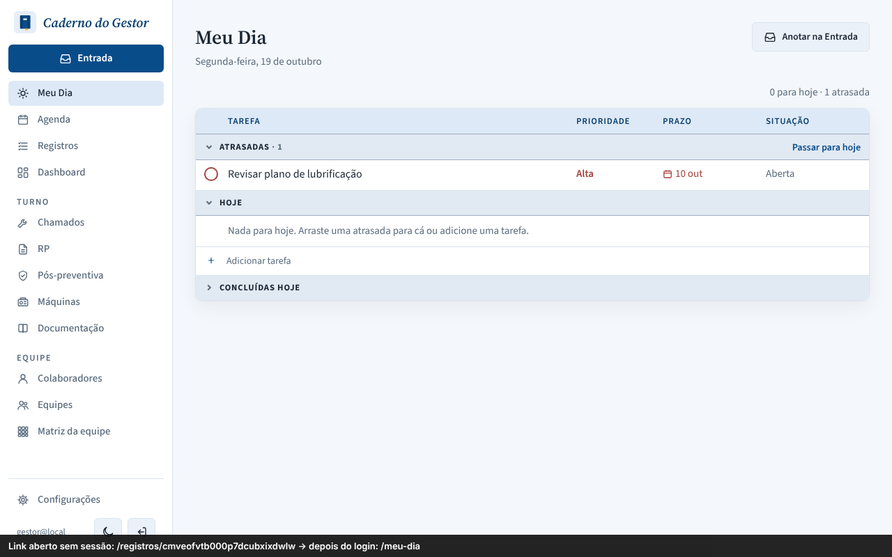
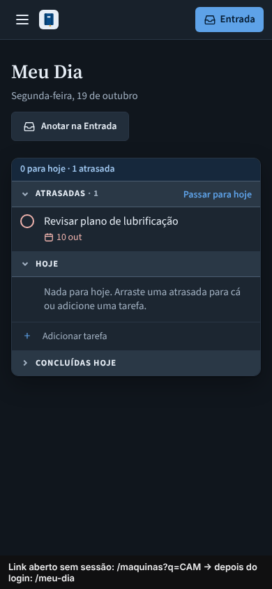
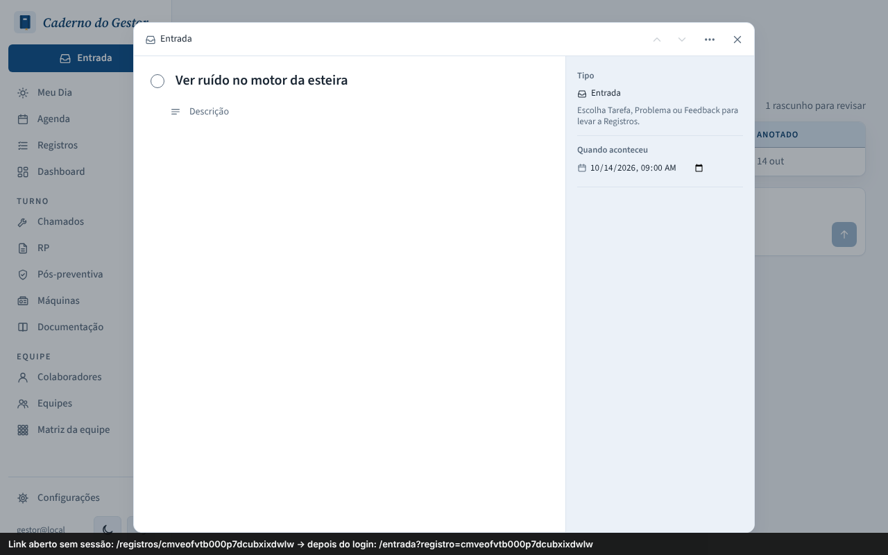
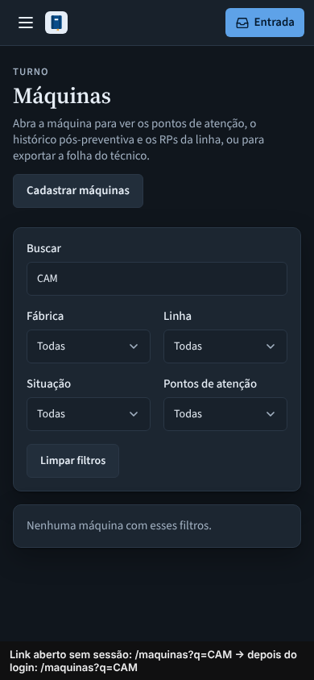

# PR #135: return to the requested page after login

An app link is opened without a session, then the user signs in. The black bar at the bottom of each screenshot (added only for this evidence) shows the link that was opened and where the app landed after login. Local app with a throwaway database.

| | Desktop, light: a task link | Mobile, dark: machines filtered by "CAM" |
|---|---|---|
| Before: always lands on Meu Dia |  |  |
| After: lands on the page that was asked for |  |  |

The task opens over the Entrada list because that task is still a draft in Entrada; that redirect is existing behavior.
