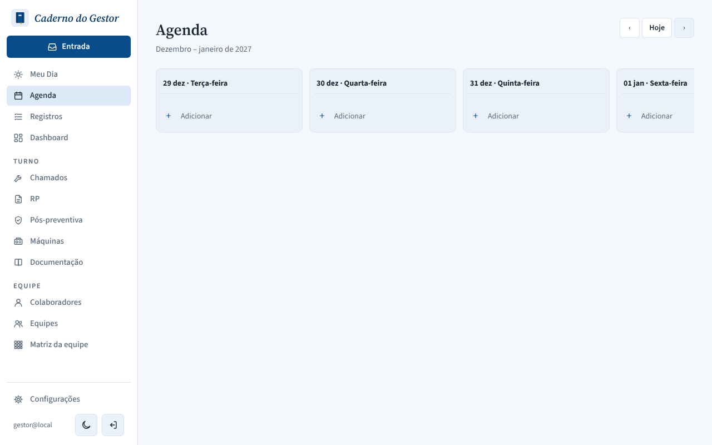
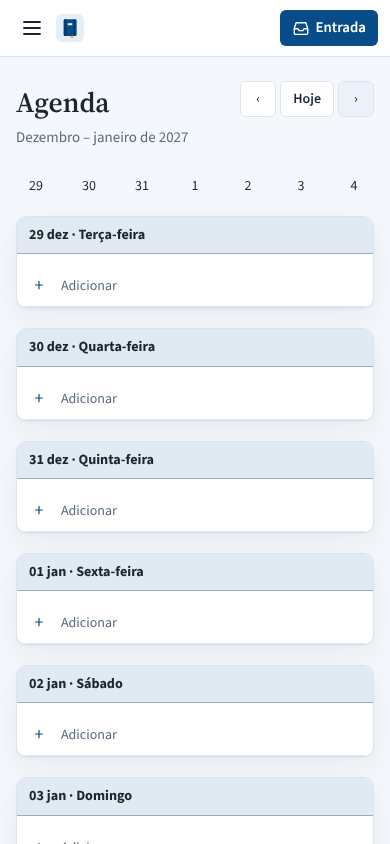
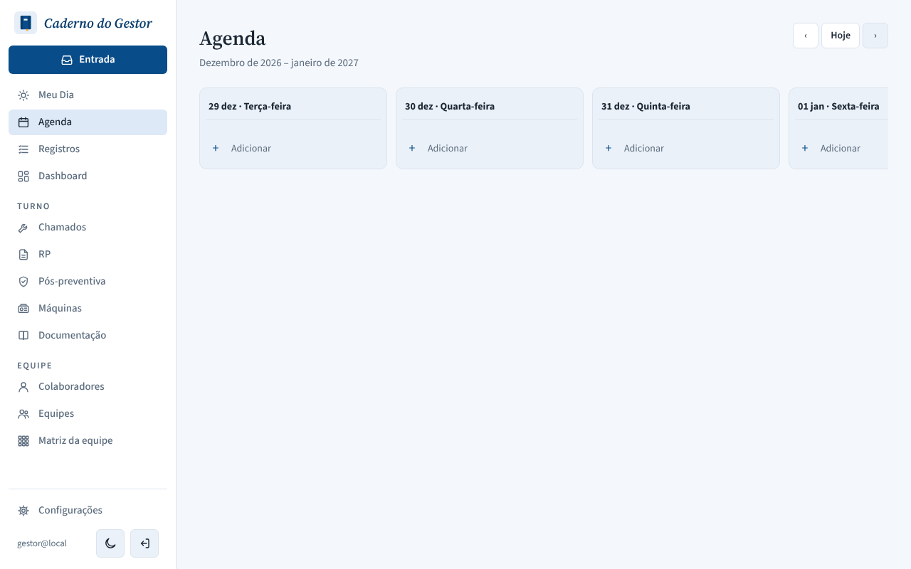
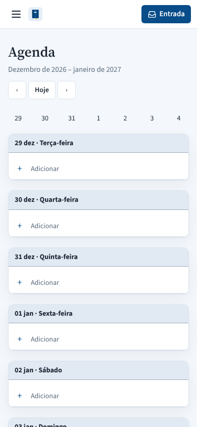

# PR #138: show both years in the agenda subtitle at year end

Agenda, ten weeks ahead of 2026-10-20 (Dec 29 – Jan 4). Local app with a throwaway database, Brasília time zone.

| | Desktop | Mobile |
|---|---|---|
| Before: "Dezembro – janeiro de 2027" |  |  |
| After: "Dezembro de 2026 – janeiro de 2027" |  |  |

On mobile, the longer subtitle pushes the week buttons onto their own line in this one week; the other weeks are unchanged.
