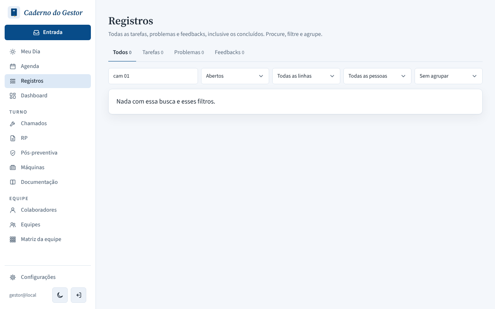
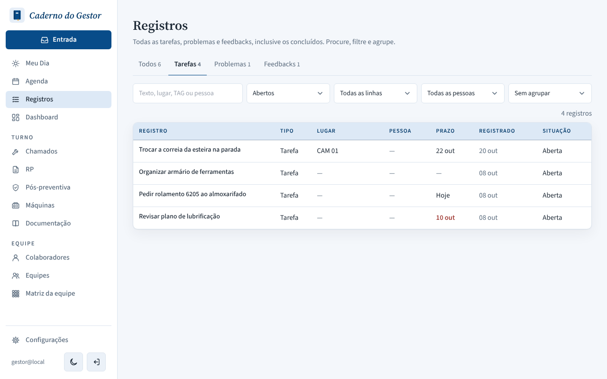
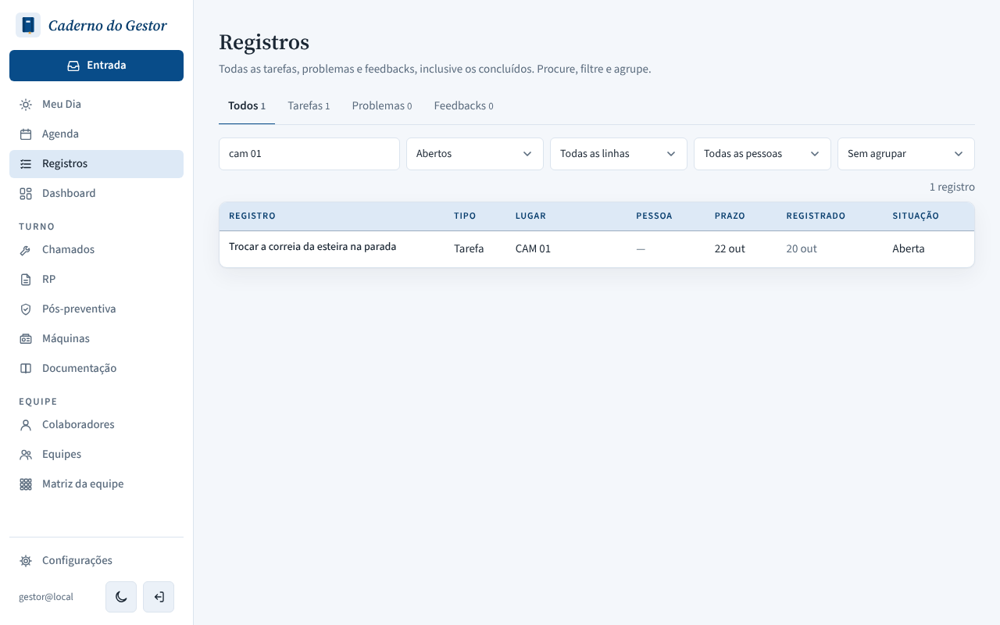
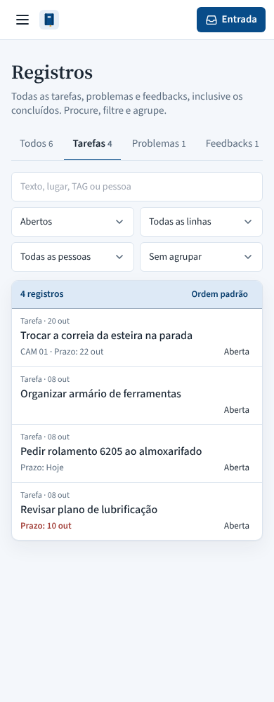

# PR #139: show a pending task's typed line in Registros

The first task ("Trocar a correia da esteira na parada") was created with "Gerar pendência" on a chamado from line CAM 01. Local app with a throwaway database.

| | Desktop, Tarefas tab | Desktop, search "cam 01" | Mobile, Tarefas tab |
|---|---|---|---|
| Before: no place, search finds nothing |  |  |  |
| After: "CAM 01" shown and found |  |  |  |
