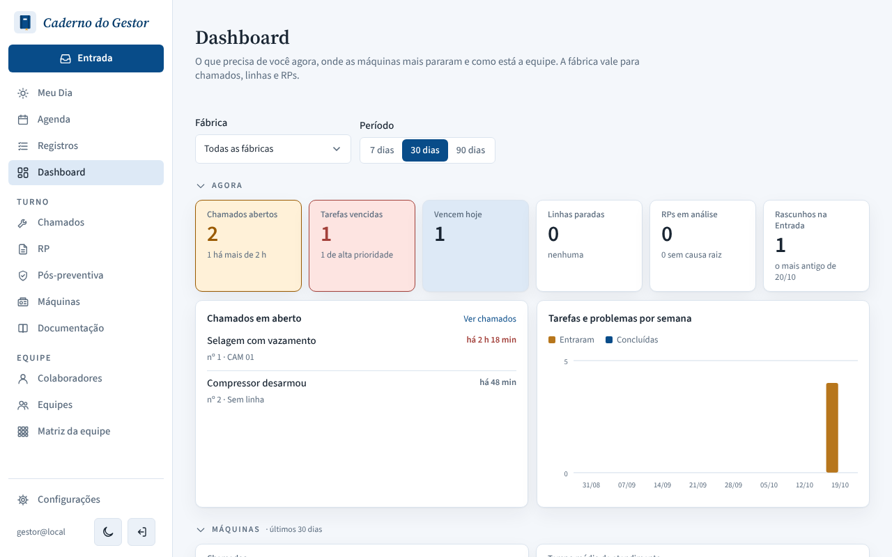
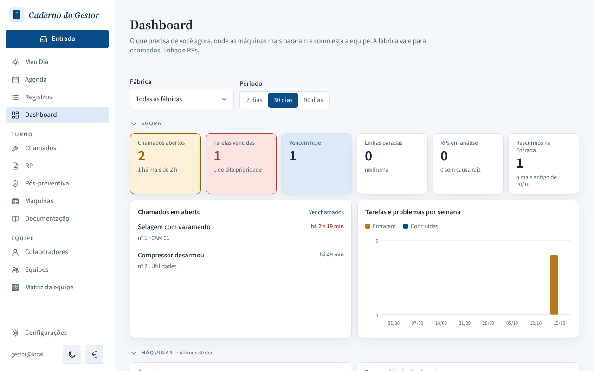
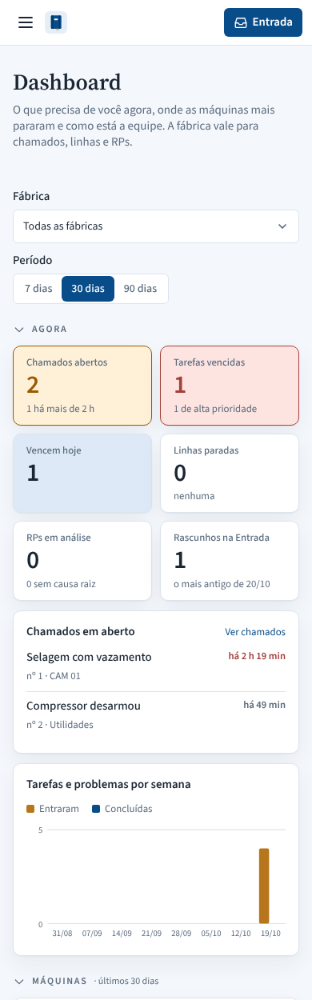
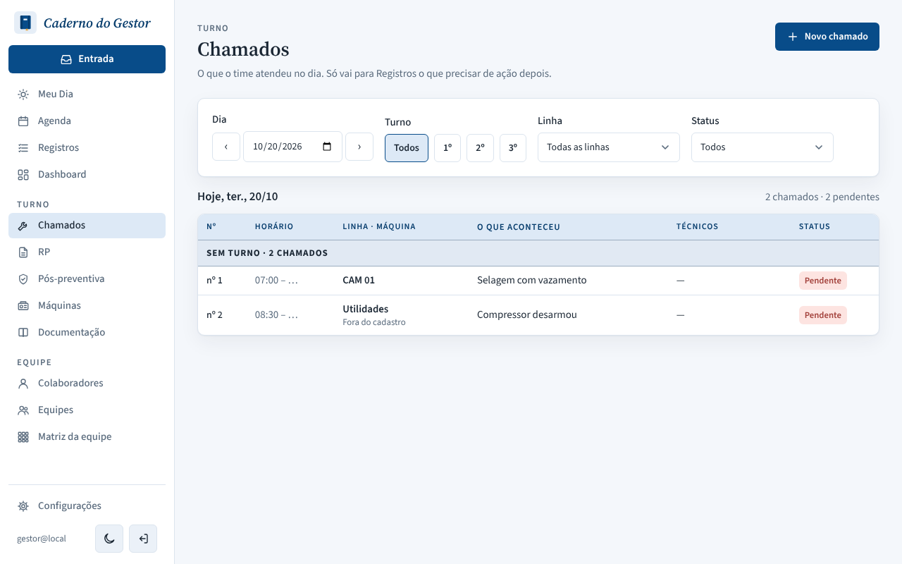

# PR #140: show a typed line for open chamados on the dashboard

Chamado nº 2 ("Compressor desarmou") was opened with the line typed by hand: "Utilidades", outside the registry. Local app with a throwaway database.

| | Desktop | Mobile |
|---|---|---|
| Before: "nº 2 · Sem linha" |  |  |
| After: "nº 2 · Utilidades" |  |  |

Reference: the Chamados screen already shows that chamado as "Utilidades · Fora do cadastro".

