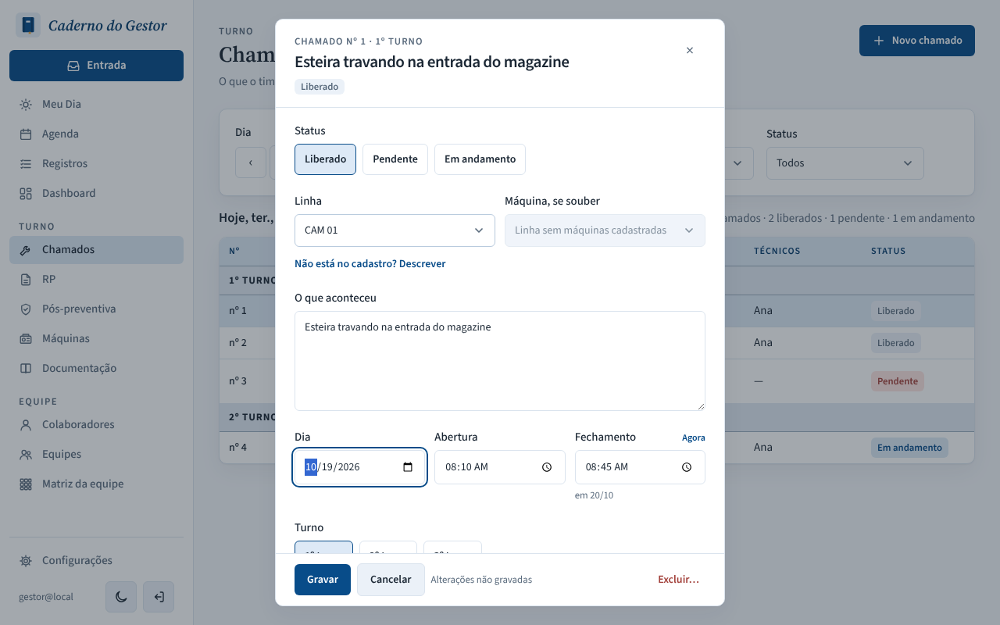
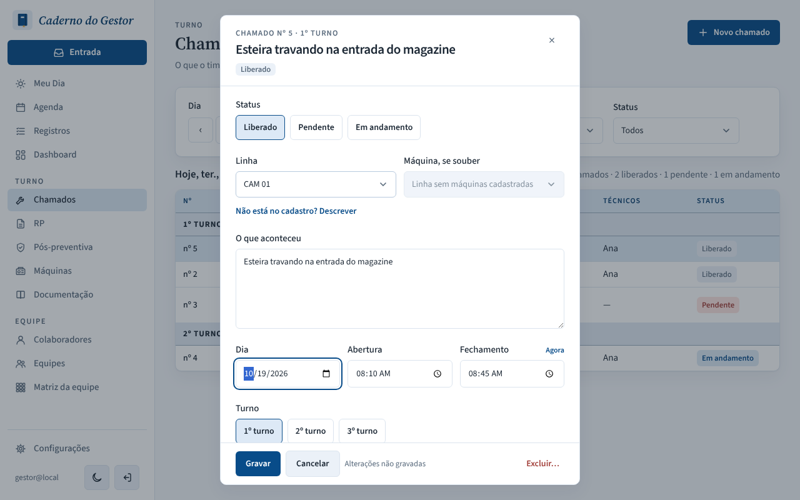
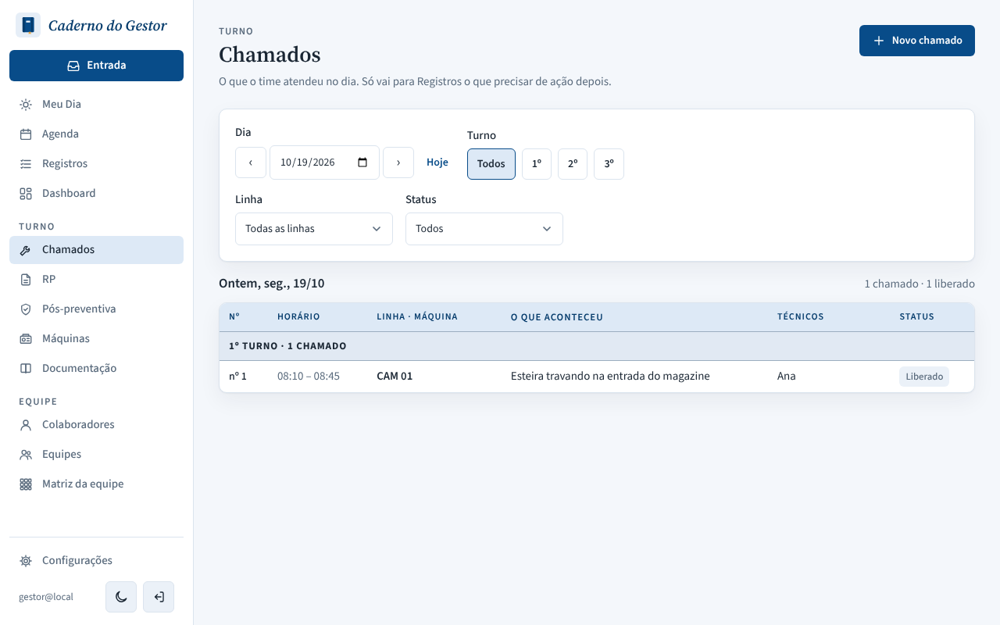

# PR #141: move the chamado closing day along when its day changes

Chamado "Esteira travando na entrada do magazine", 08:10 – 08:45 on 20/10 (35 min). In the panel, the Dia was changed to 19/10, then Gravar. Local app with a throwaway database, browser in the São Paulo time zone.

| | Panel after changing the Dia | Saved by the API |
|---|---|---|
| Before |  Fechamento still says "em 20/10" | `closedAt` 2026-10-20 08:45, `durationMin` 1475 (24h35) |
| After |  closing moves to 19/10 with the opening | `closedAt` 2026-10-19 08:45, `durationMin` 35 |

Before, the list of 19/10 still shows "08:10 – 08:45", so the extra day is hidden; only the Dashboard's average service time picks it up.

