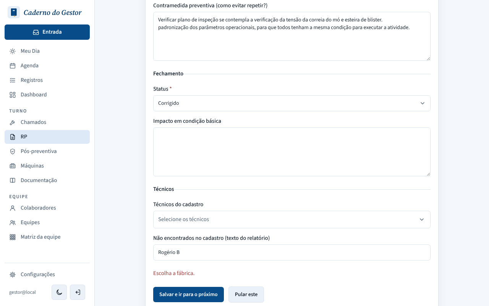
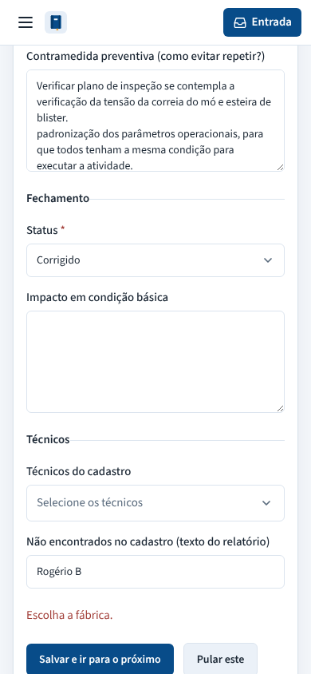
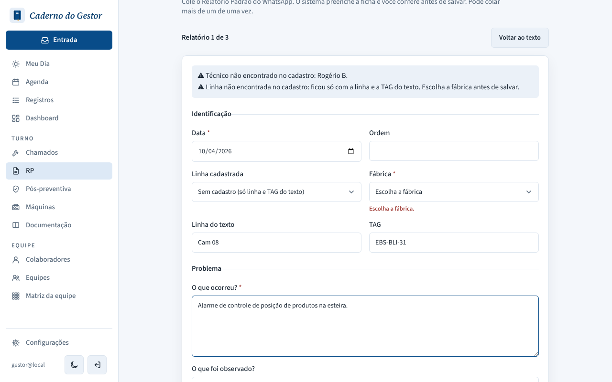
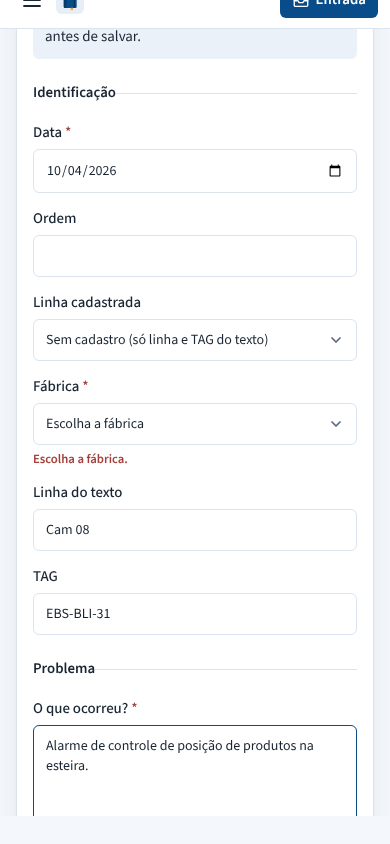

# PR #142: show RP form errors under the missing field

Pasted the three sample RPs from `apps/api/src/rp/domain/fixtures` in Colar RP. The line "Cam 08" is not in the registry, so the Fábrica stays empty. Clicked "Salvar e ir para o próximo" without choosing one. Local app with a throwaway database.

| | Desktop | Mobile |
|---|---|---|
| Before: "Escolha a fábrica." only under the button, page stays at the bottom (form scrolled ~1,745 px on desktop, ~2,180 px on mobile) |  |  |
| After: error under Fábrica, page scrolls there and focuses the field |  |  |
