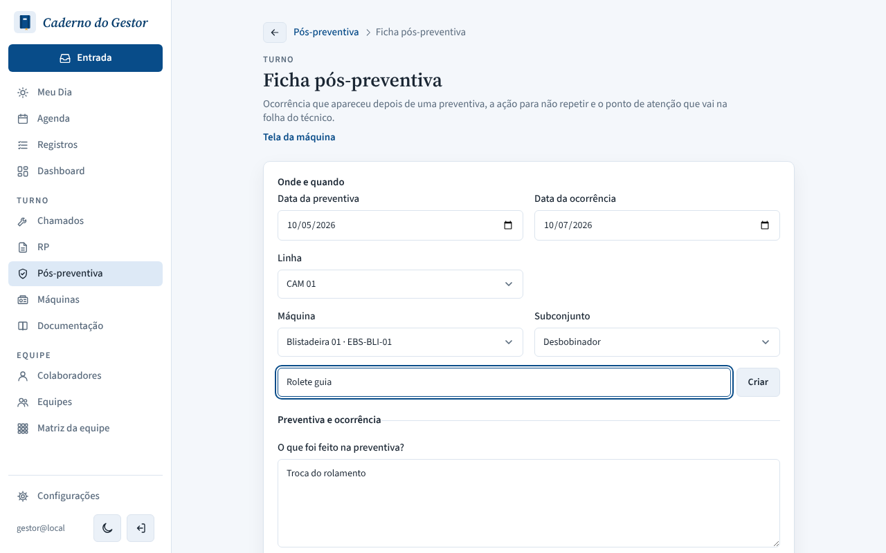
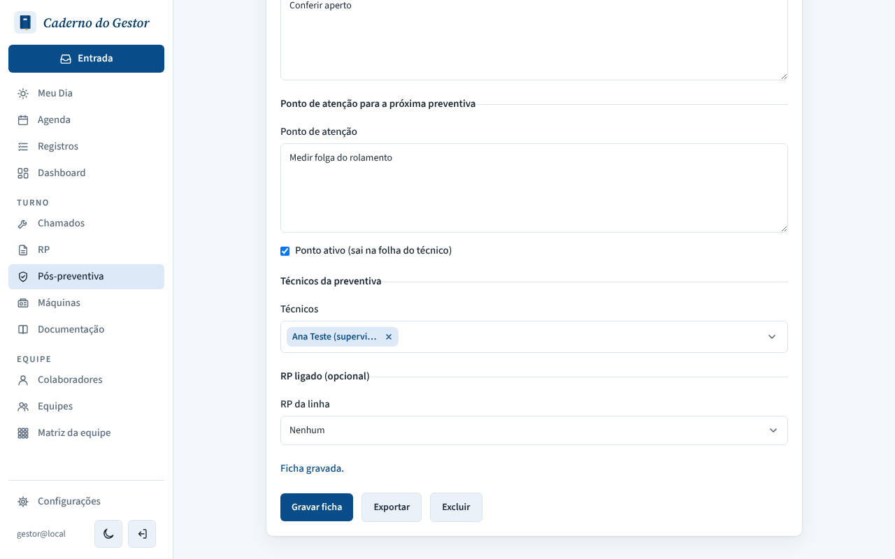
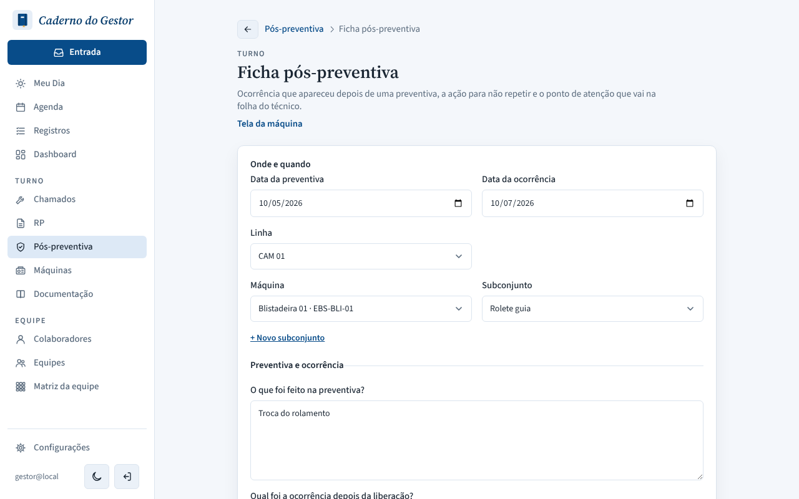

# PR #143: create the subassembly on Enter instead of saving the form

Ficha pós-preventiva of Blistadeira 01 (subassembly Desbobinador). Clicked "+ Novo subconjunto", typed "Rolete guia" and pressed Enter. Local app with a throwaway database; requests recorded by the browser.

| | What the screen shows | Requests sent |
|---|---|---|
| Before |  The name stays in the field, Subconjunto is still Desbobinador. Further down, "Ficha gravada."  | `PATCH /api/post-preventives/…` only. No subassembly created. |
| After |  "Rolete guia" is created and already chosen in Subconjunto; the ficha is not saved | `POST /api/subassemblies` only |
