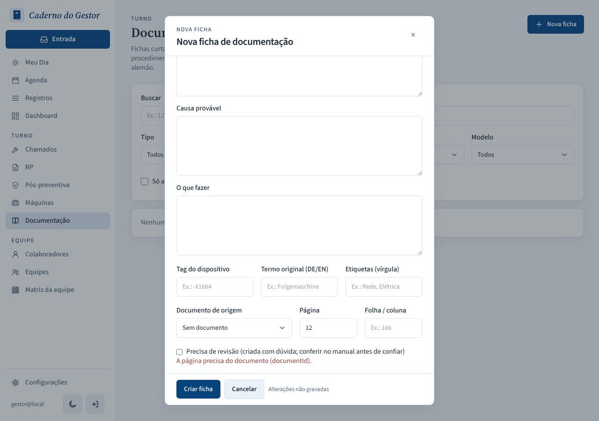
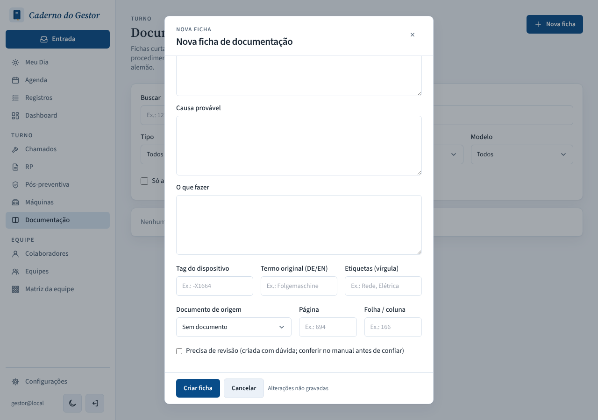
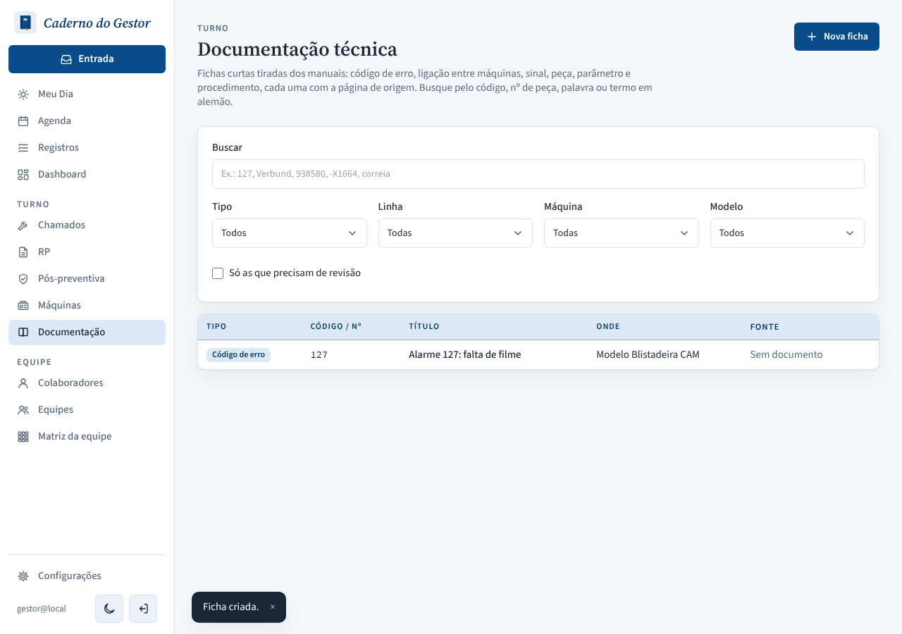
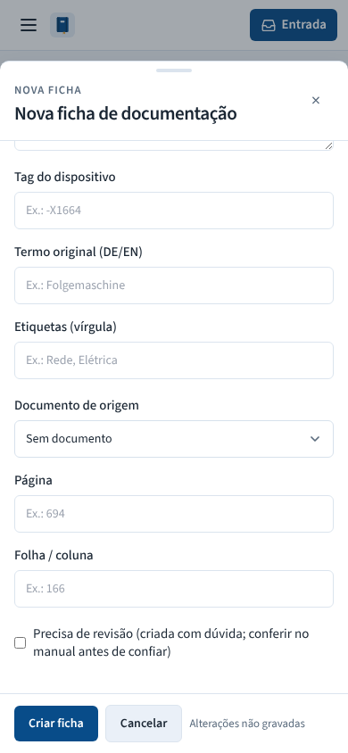

# PR #145: "Nova ficha" drops the page together with the source document

Local environment. Steps: Documentação > Nova ficha > model Blistadeira CAM, code 127, title, "Documento de origem" = Manual da Blistadeira, Página = 12, then "Documento de origem" back to "Sem documento" and "Criar ficha".

| | |
|---|---|
| Before: the disabled Página still holds 12 |  |
| Before: Criar ficha → 400 "A página precisa do documento (documentId)." and the field can't be cleared |  |
| After: Página is empty when the document goes |  |
| After: the card is created (POST sent `page: null`, 201) |  |
| After, phone |  |
