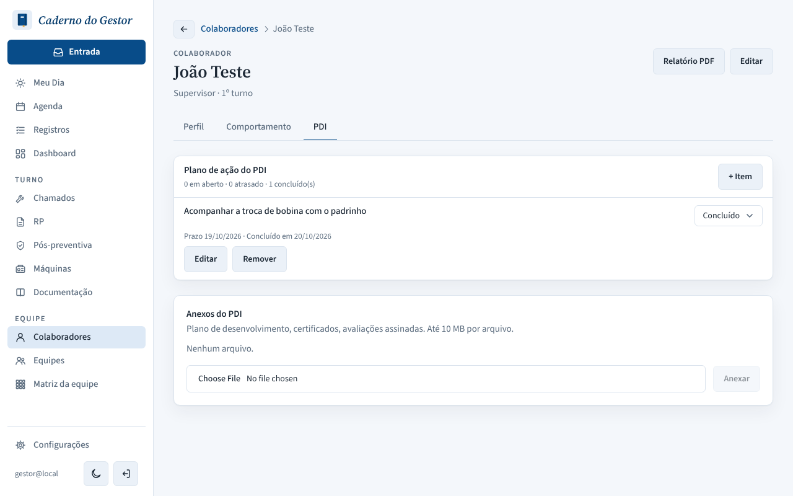
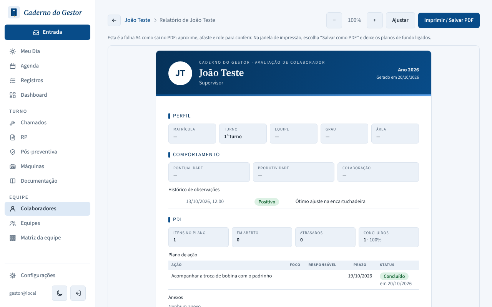
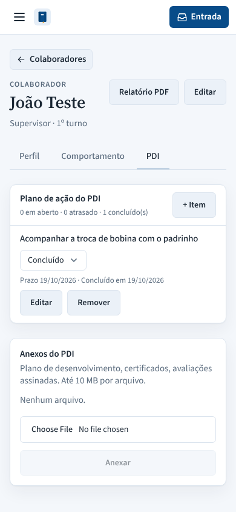

# PR #146: PDI completion day in Brasília time

Local environment. João Teste has one PDI item marked done at 2026-10-19 22:30 in Brasília (stored as `2026-10-20T01:30:00Z`).

| | |
|---|---|
| Before, PDI tab: "Concluído em 20/10/2026" |  |
| Before, PDF report: "em 20/10/2026" |  |
| After, PDI tab: "Concluído em 19/10/2026" |  |
| After, PDF report: "em 19/10/2026" |  |
| After, phone |  |
