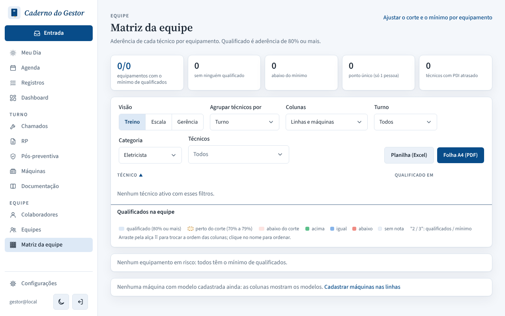
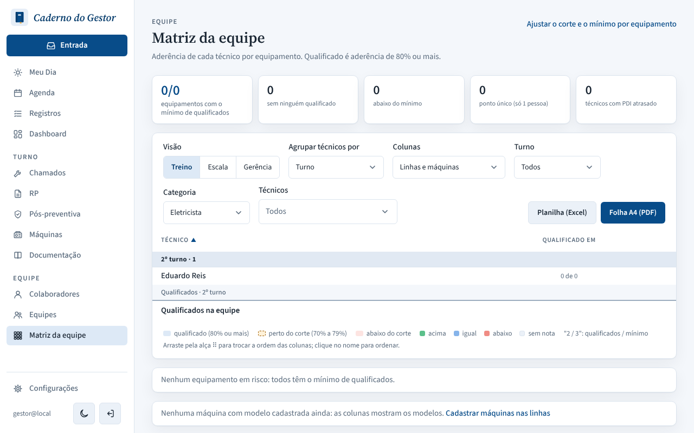
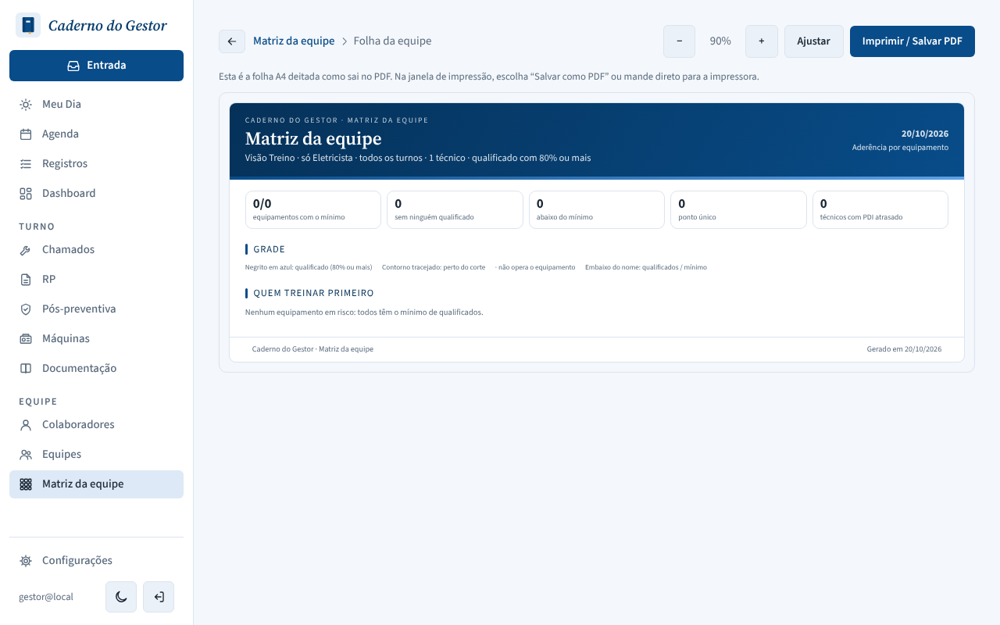
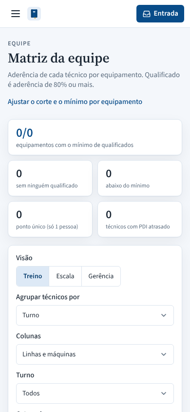

# PR #147: Team matrix no longer goes empty when the category hides a chosen technician

Local environment: Carlos Lima (role with category Mecânico) and Eduardo Reis (role with category Eletricista). Steps: in Matriz da equipe, choose Carlos in "Técnicos", then set "Categoria" to Eletricista (URL `/competencias?tecnicos=<Carlos>&categoria=electrical`).

| | |
|---|---|
| Before: "Técnicos" says Todos, but the grid says "Nenhum técnico ativo com esses filtros" |  |
| After: the grid shows the electricians (Eduardo Reis), matching "Todos" |  |
| After, A4 sheet with the same URL filters: "1 técnico" |  |
| After, phone |  |
