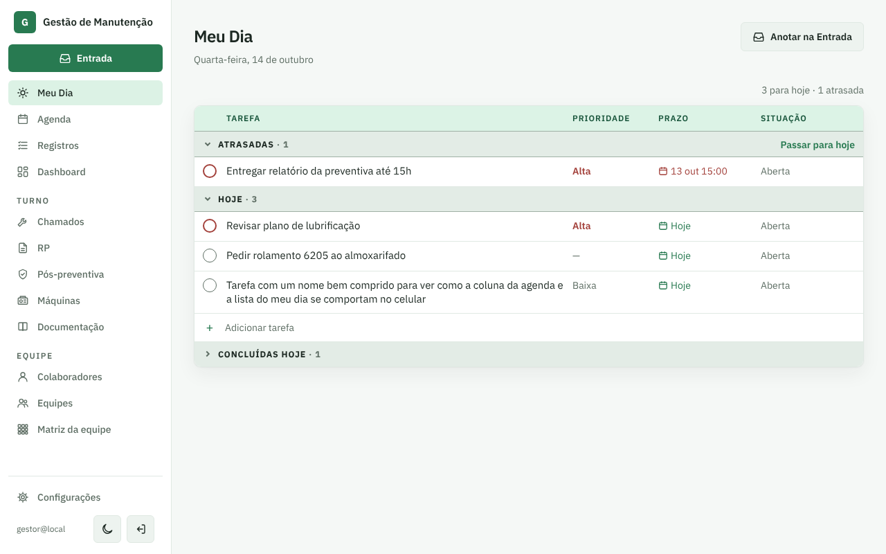
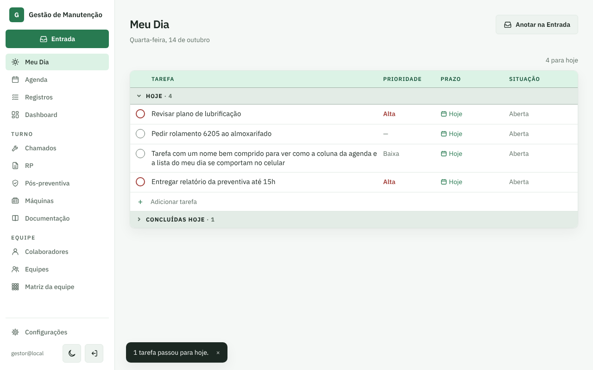
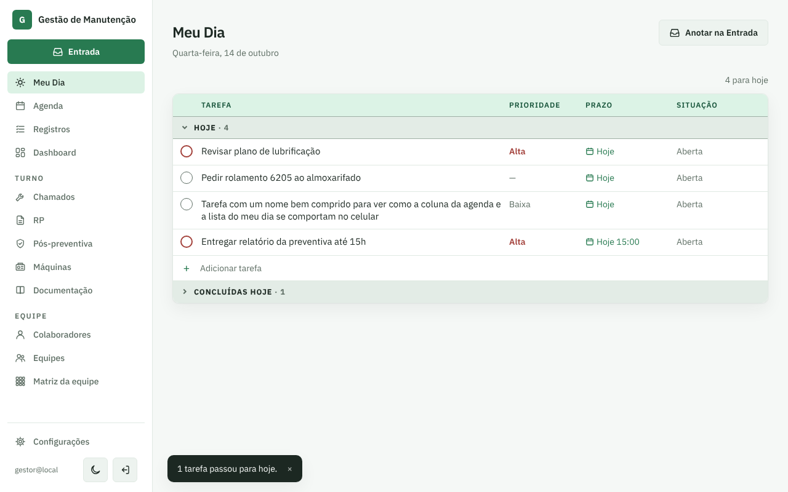
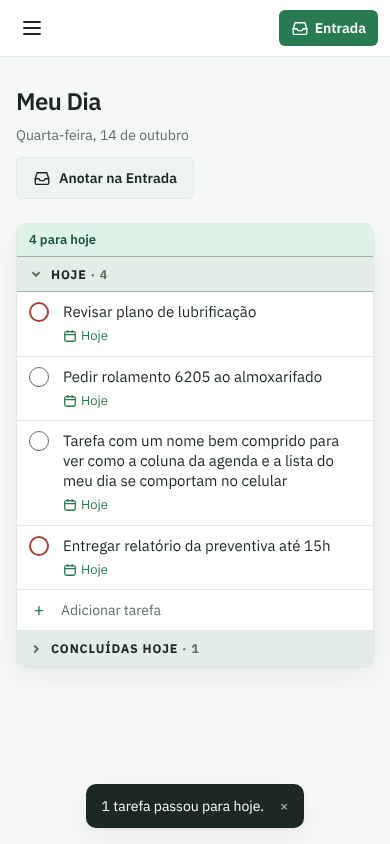
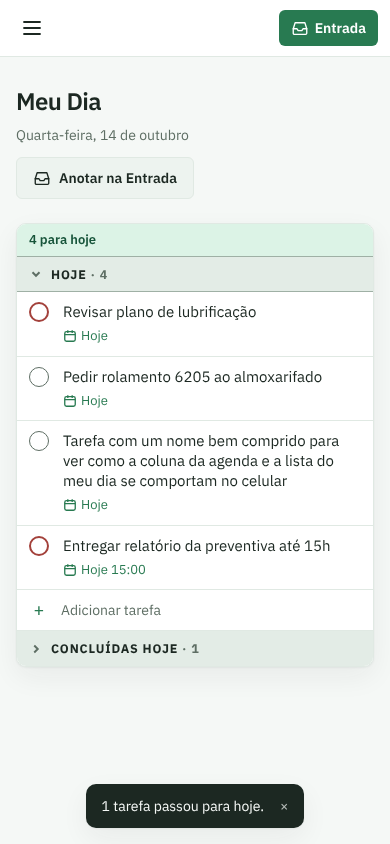

# PR #65: "Passar para hoje" mantém o horário do prazo

PR: https://github.com/LeonardoBrum0907/gestao-manutencao/pull/65

A tarefa atrasada antes do clique (prazo 13 out 15:00):

Depois de clicar em "Passar para hoje":

| | Antes da correção | Depois da correção |
| --- | --- | --- |
| Computador |  |  |
| Celular |  |  |
