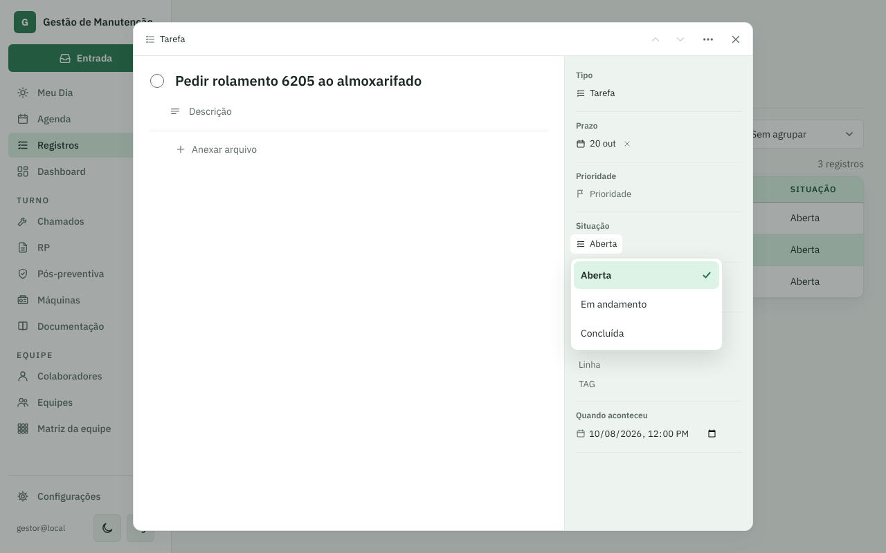
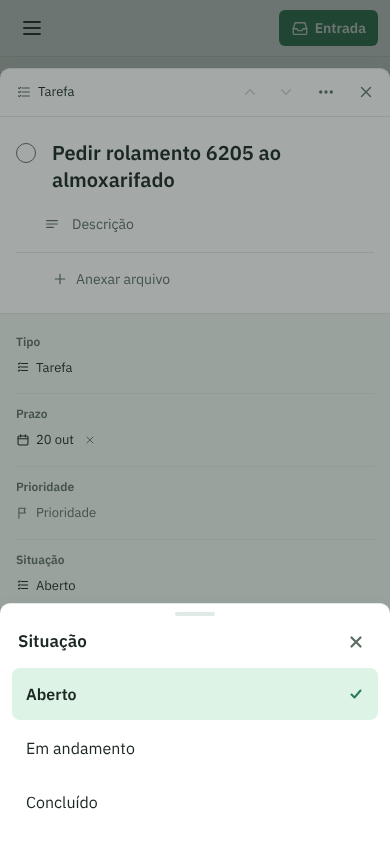
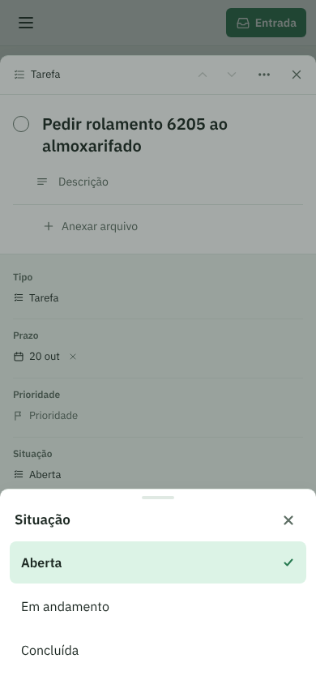
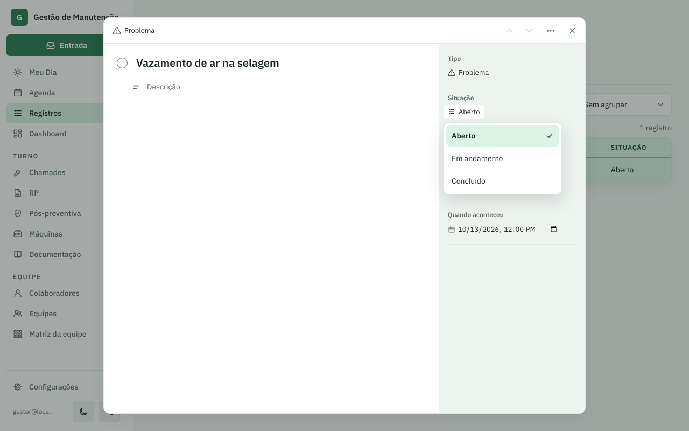
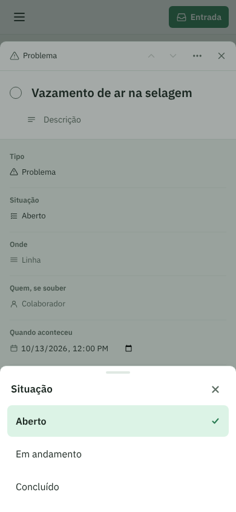
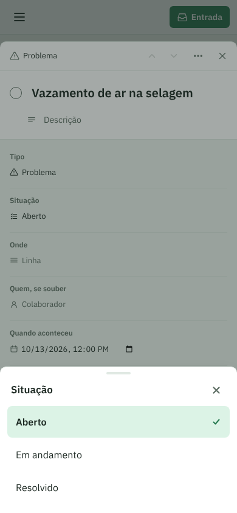

# PR #66: ficha do registro com a situação igual à lista

PR: https://github.com/LeonardoBrum0907/gestao-manutencao/pull/66

Ficha aberta por cima da lista de Registros, com o seletor de Situação aberto. Atrás, a lista diz "Aberta".

| | Antes da correção | Depois da correção |
| --- | --- | --- |
| Tarefa, computador |  |  |
| Tarefa, celular |  |  |
| Problema, computador |  |  |
| Problema, celular |  |  |
