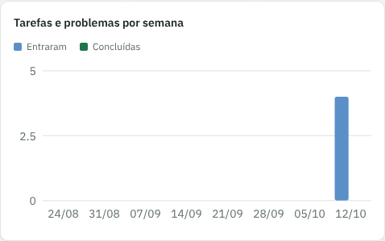
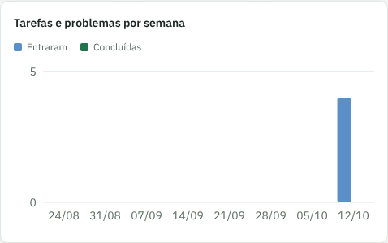
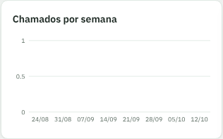
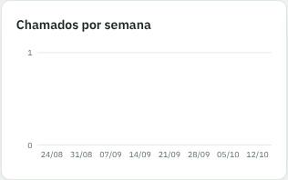
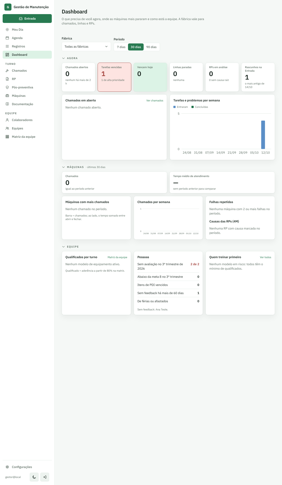

# PR #67: Dashboard com eixo dos gráficos só em números inteiros

PR: https://github.com/LeonardoBrum0907/gestao-manutencao/pull/67

Dashboard com 4 tarefas entrando na semana de 12/10 e nenhum chamado. Período: 30 dias.

| | Antes da correção | Depois da correção |
| --- | --- | --- |
| Tarefas e problemas por semana |  |  |
| Chamados por semana (vazio) |  |  |
| Página inteira, computador |  |  |
| Página inteira, celular |  |  |
