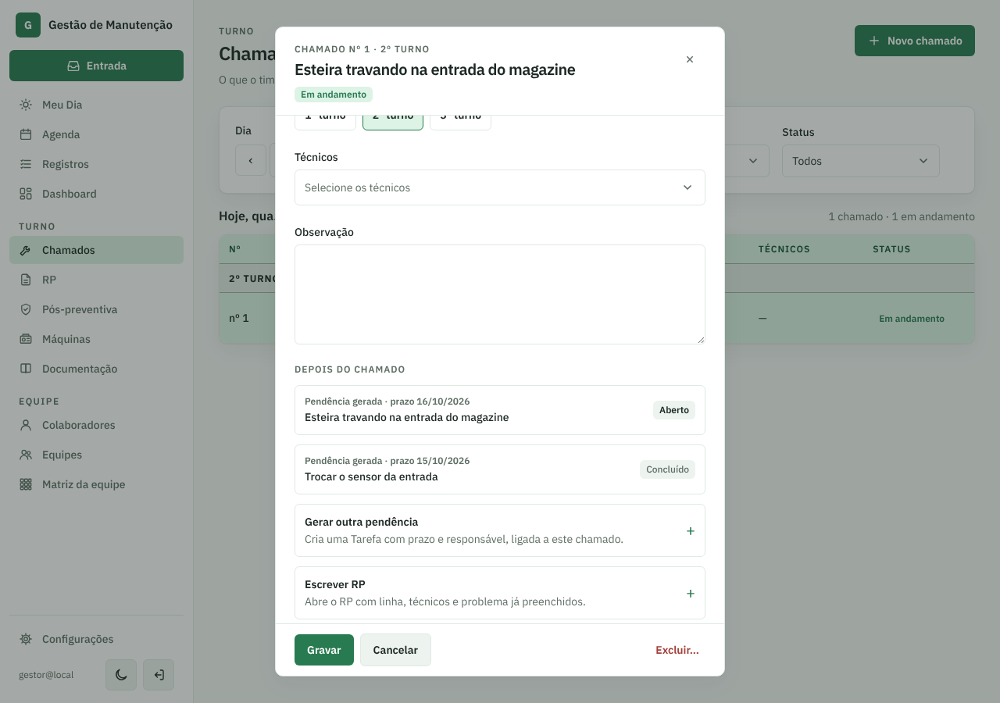
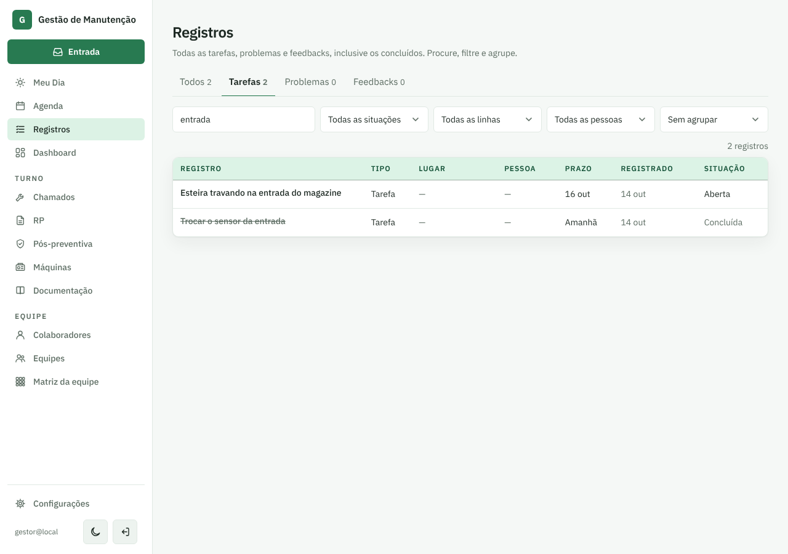
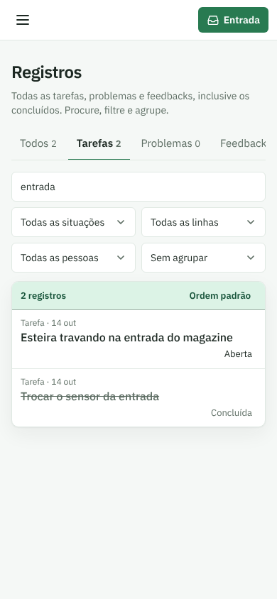

# PR #68: pendência do chamado com a situação de tarefa

PR: https://github.com/LeonardoBrum0907/gestao-manutencao/pull/68

Chamado nº 1 aberto, rolado até "Depois do chamado". Duas pendências geradas: uma aberta e uma concluída.

| | Antes da correção | Depois da correção |
| --- | --- | --- |
| Computador |  |  |
| Celular |  |  |

As mesmas duas tarefas em Registros, que já diziam "Aberta" e "Concluída" (não mudou):

| Computador | Celular |
| --- | --- |
|  |  |
