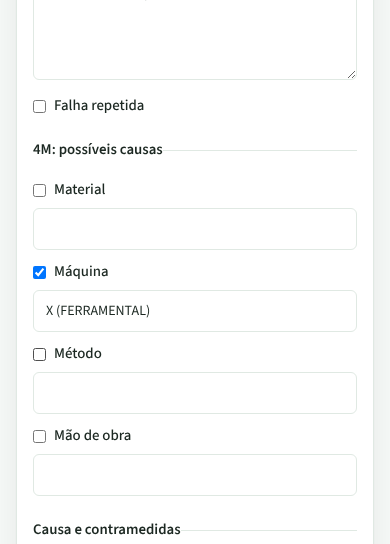
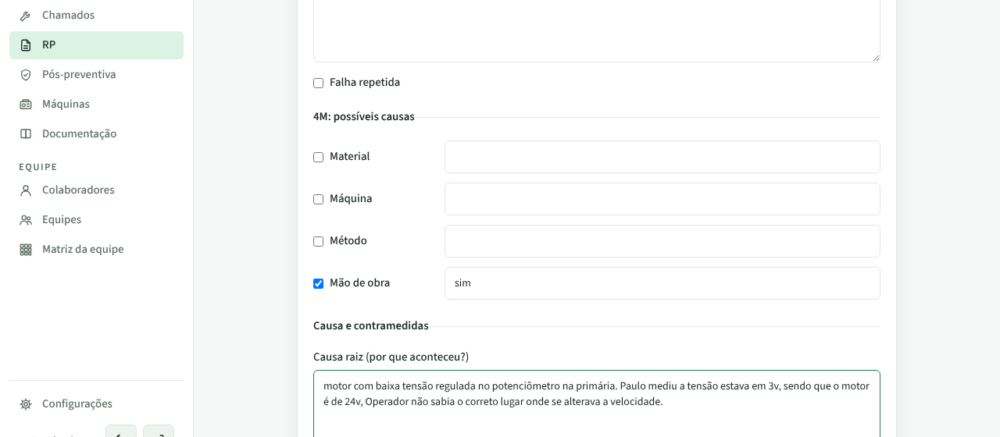

# PR #72: causa do 4M sem a marca do técnico

PR: https://github.com/LeonardoBrum0907/gestao-manutencao/pull/72

Colar RP com dois relatórios reais (os exemplos do repositório): o RP2 traz "MÁQUINA: X (FERRAMENTAL)" e o RP3 traz
"MÃO DE OBRA: sim". Prints da ficha logo depois de "Interpretar", no bloco "4M: possíveis causas".

| | Antes da correção | Depois da correção |
| --- | --- | --- |
| RP2, computador |  |  |
| RP2, celular |  |  |
| RP3, computador |  |  |
| RP3, celular |  |  |
