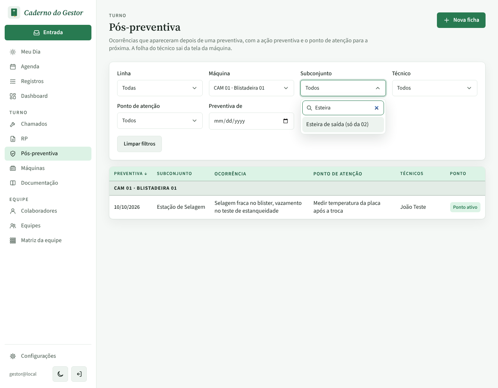
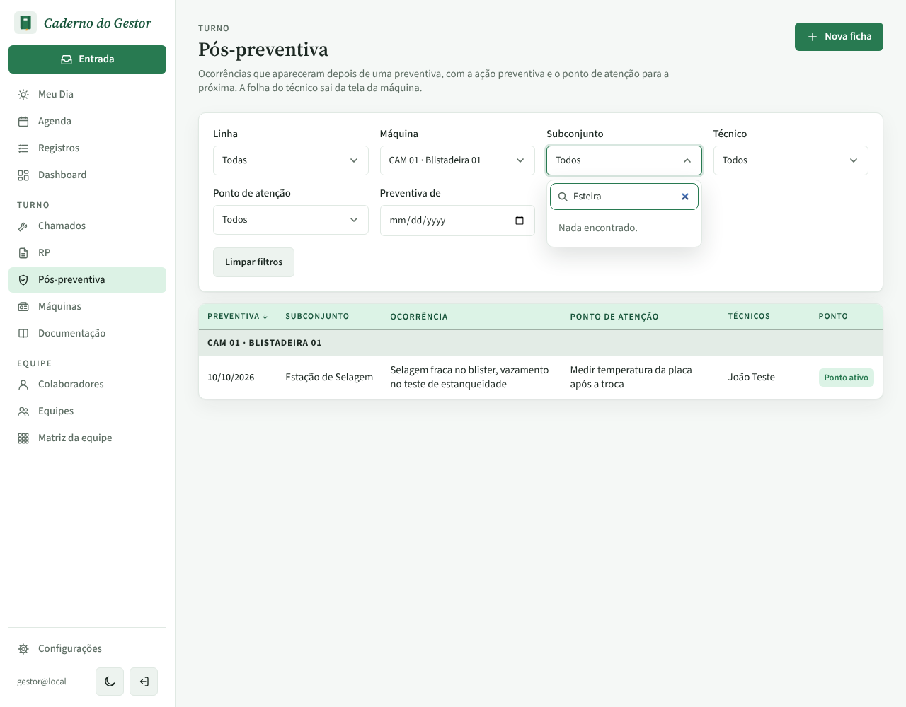
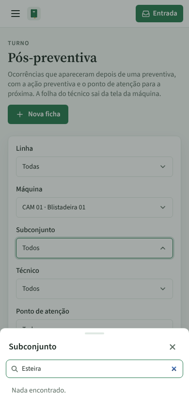

# PR #73: filtro Subconjunto só com os da máquina escolhida

PR: https://github.com/LeonardoBrum0907/gestao-manutencao/pull/73

Lista de Pós-preventiva filtrada pela Blistadeira 01. O modelo dela (Blistadeira CAM) tem um subconjunto que é só da
Blistadeira 02, "Esteira de saída (só da 02)". Prints com o filtro Subconjunto aberto e "Esteira" digitado na busca.

| | Antes da correção | Depois da correção |
| --- | --- | --- |
| Computador |  |  |
| Celular |  |  |

Na Blistadeira 02 o subconjunto continua aparecendo no filtro (conferido no app local).
