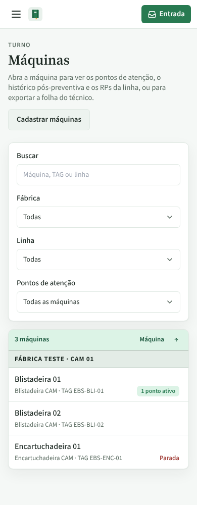
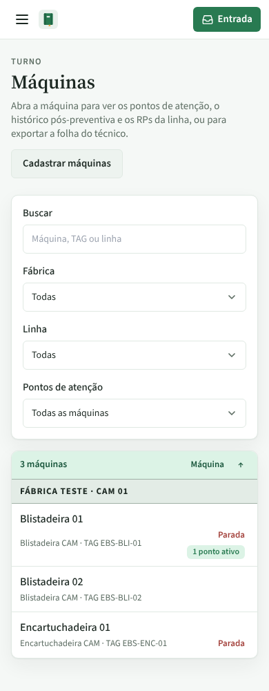

# PR #75: "Parada" junto com os pontos ativos na lista do celular

PR: https://github.com/LeonardoBrum0907/gestao-manutencao/pull/75

Lista de Máquinas no celular (390 px). A Blistadeira 01 está parada e tem 1 ponto de atenção ativo; a
Encartuchadeira 01 está parada sem ponto. No computador a coluna Situação já mostrava "Parada" nas duas.

| | Antes da correção | Depois da correção |
| --- | --- | --- |
| Celular, tema claro |  |  |
| Celular, tema escuro |  |  |
