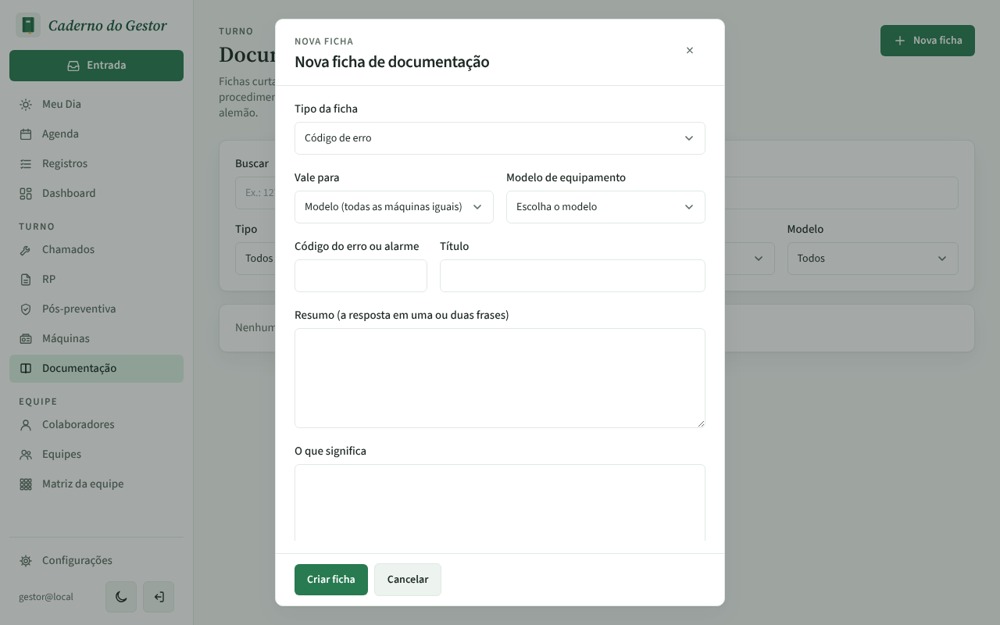
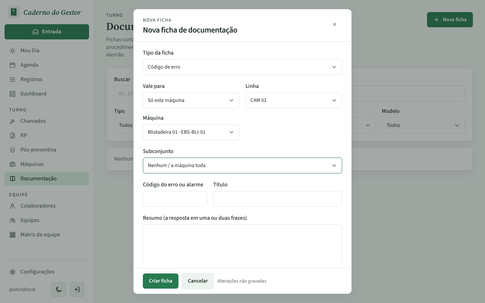
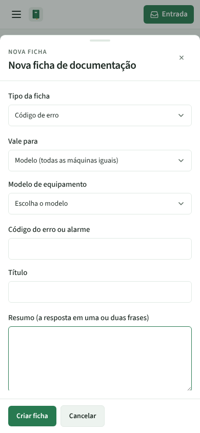
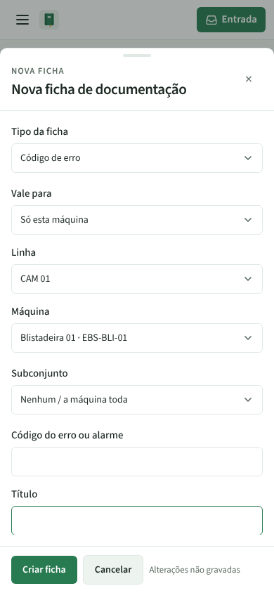

# PR #77: "Vale para" da nova ficha muda de verdade

PR: https://github.com/LeonardoBrum0907/gestao-manutencao/pull/77

Documentação › Nova ficha. Nos dois casos o print foi tirado depois de escolher "Só esta máquina" no campo
"Vale para" (e, no depois, a linha CAM 01 e a máquina Blistadeira 01). Antes, o campo voltava sozinho para
"Modelo (todas as máquinas iguais)" e os campos Linha e Máquina nunca apareciam.

| | Antes da correção | Depois da correção |
| --- | --- | --- |
| Computador |  |  |
| Celular |  |  |
