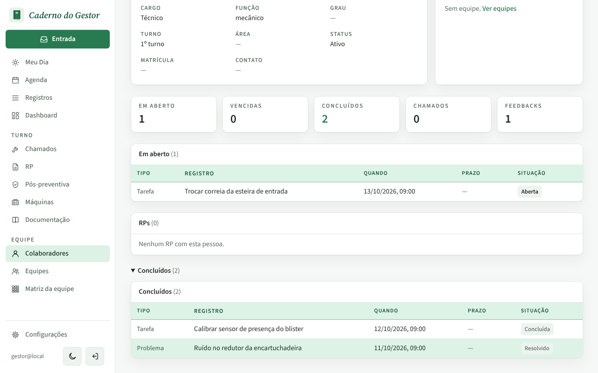
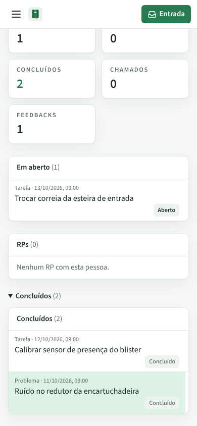

# PR #78: situação dos registros na ficha do colaborador

PR: https://github.com/LeonardoBrum0907/gestao-manutencao/pull/78

Ficha do João Teste, aba Perfil, com a seção Concluídos aberta. Ele tem uma tarefa em aberto, uma tarefa concluída e
um problema resolvido. Antes, a coluna dizia "Aberto" e "Concluído" para tudo; agora usa as mesmas palavras da lista
de Registros ("Aberta", "Concluída", "Resolvido"), e o cabeçalho passa de "Status" para "Situação".

| | Antes da correção | Depois da correção |
| --- | --- | --- |
| Computador |  |  |
| Celular |  |  |
