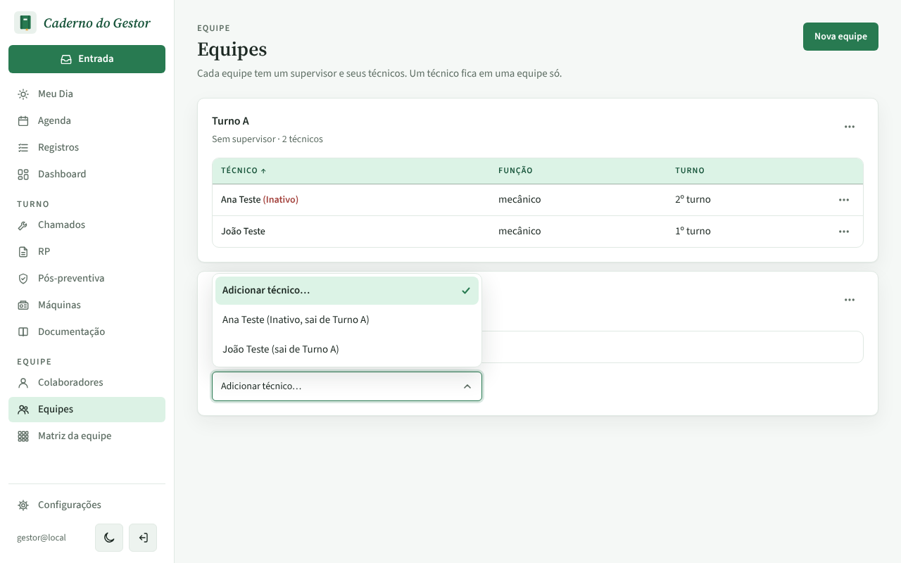
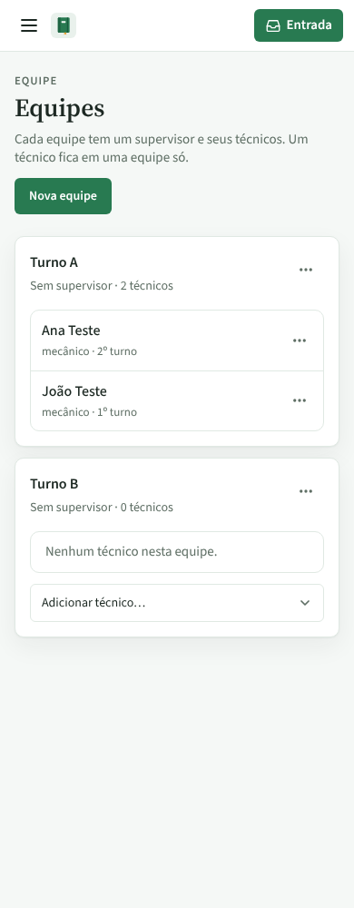
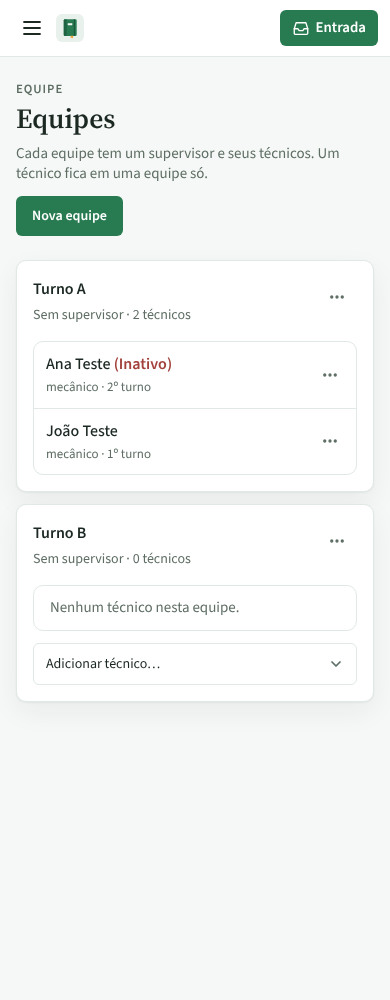
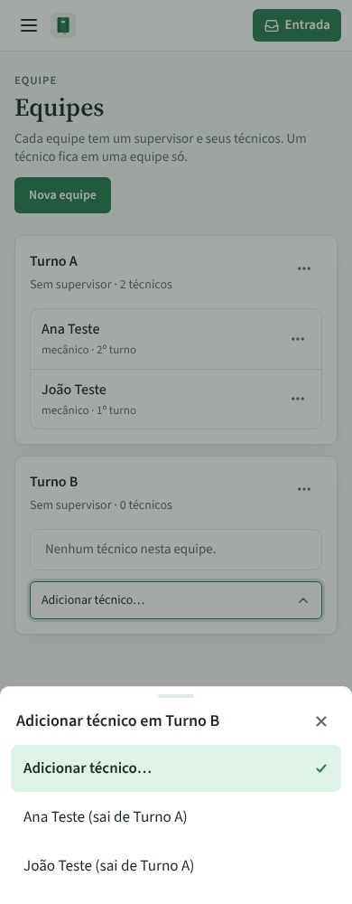
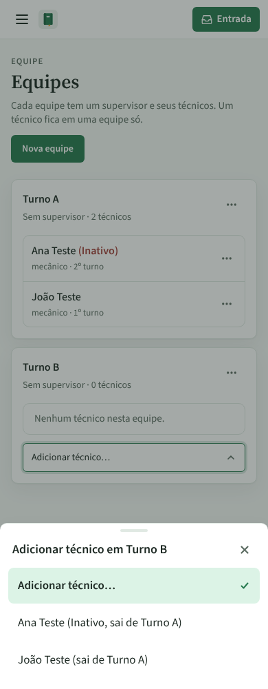

# PR #79: situação do técnico na equipe

PR: https://github.com/LeonardoBrum0907/gestao-manutencao/pull/79

Equipes com Turno A (Ana Teste, marcada como Inativa no cadastro, e João Teste) e Turno B vazia, com
"Adicionar técnico…" do Turno B aberto. Antes, a Ana aparecia igual ao João no cartão e na lista; o supervisor e o
select de supervisor já mostravam a situação entre parênteses.

| | Antes da correção | Depois da correção |
| --- | --- | --- |
| Computador, lista aberta |  |  |
| Celular, cartões |  |  |
| Celular, lista aberta |  |  |
