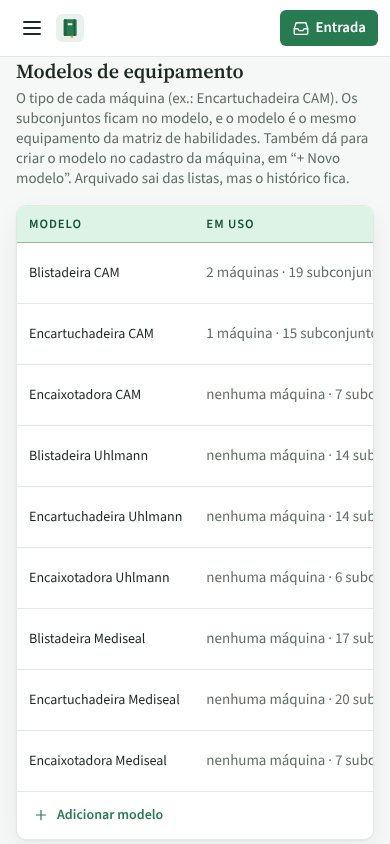
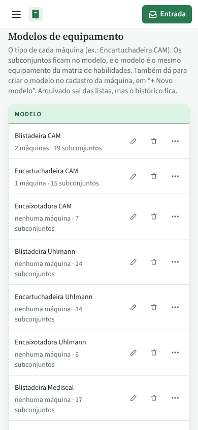
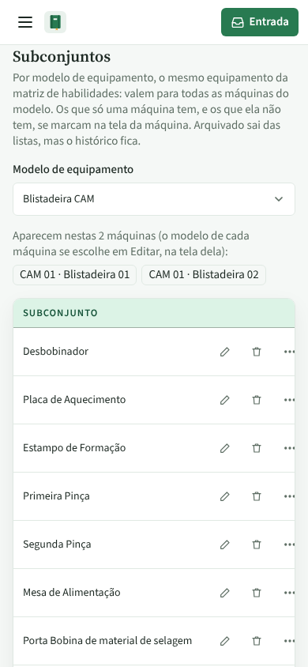
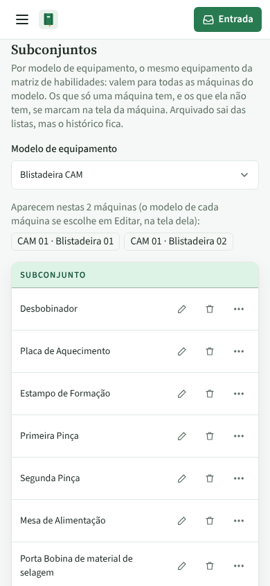
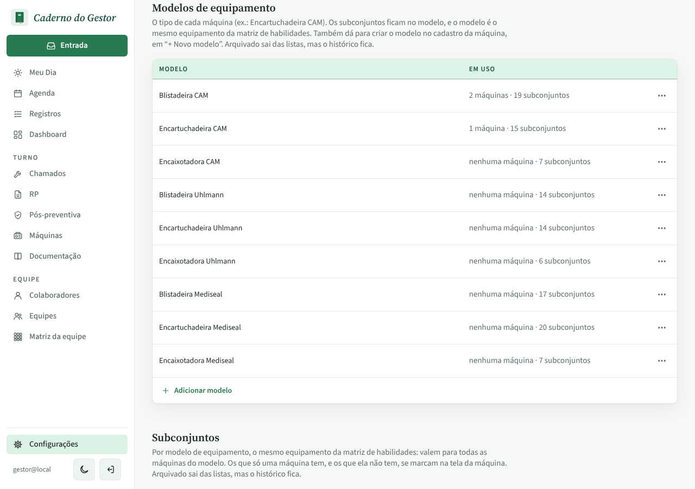
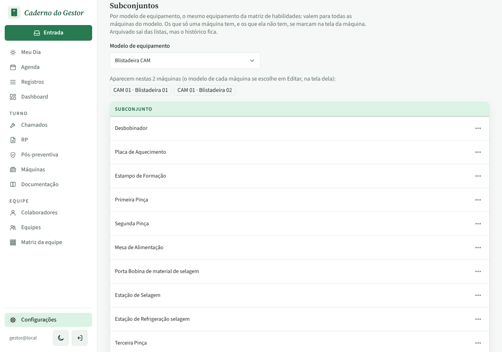
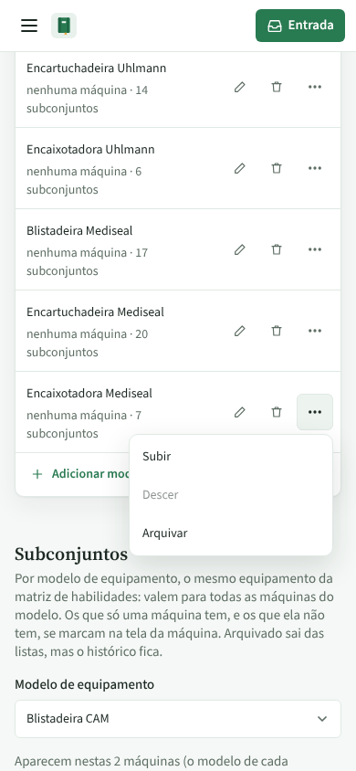

# PR #80: listas de Configurações no celular

PR: https://github.com/LeonardoBrum0907/gestao-manutencao/pull/80

Configurações › Fábricas, linhas e máquinas, celular de 390 px e computador de 1280 px, tema claro. Antes, no
celular, a tabela de Modelos de equipamento media 573 px numa caixa de 356 px e os botões de renomear, excluir e ⋯
ficavam fora da tela; em Subconjuntos, o nome comprido empurrava o ⋯ para fora (378 px em 356). No computador as
imagens de antes e depois são idênticas pixel a pixel.

| | Antes da correção | Depois da correção |
| --- | --- | --- |
| Celular, Modelos de equipamento |  |  |
| Celular, Subconjuntos |  |  |
| Computador, Modelos de equipamento |  |  |
| Computador, Subconjuntos |  |  |

Depois, no celular, o menu ⋯ do último modelo abre normalmente:

