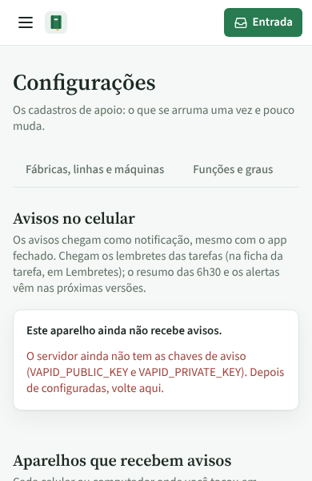
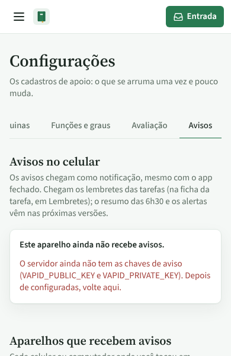
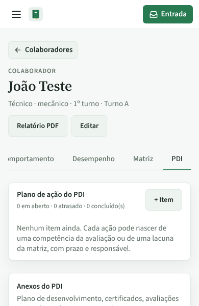
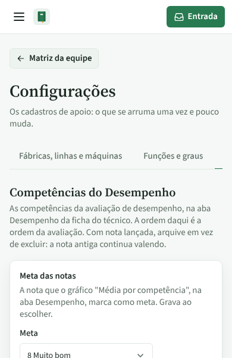
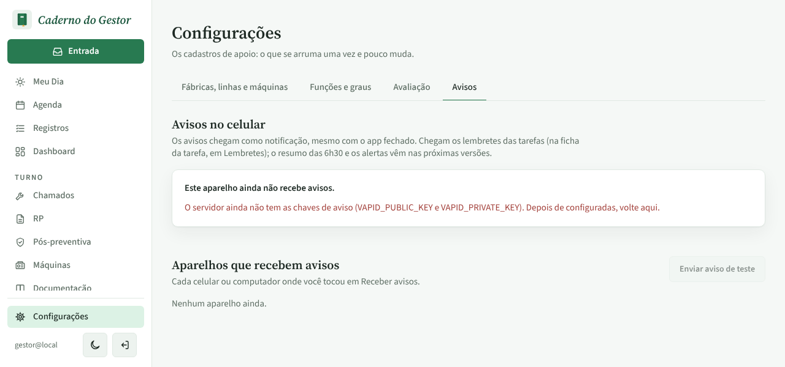
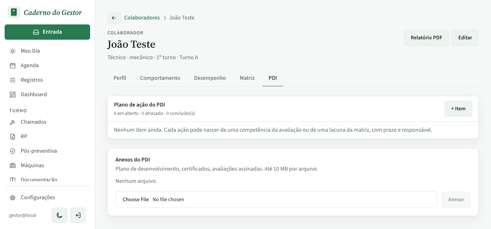

# PR #81: aba atual à vista no celular

PR: https://github.com/LeonardoBrum0907/gestao-manutencao/pull/81

Celular de 390 px e computador de 1280 px, tema claro, abrindo cada página por link direto. Antes, no celular, a
aba atual ficava fora da faixa de abas, à direita, nos quatro casos. Depois, a faixa já abre rolada até ela. No
computador todas as abas cabem e nada muda.

| | Antes da correção | Depois da correção |
| --- | --- | --- |
| Celular, Configurações › Avaliação |  |  |
| Celular, Configurações › Avisos |  |  |
| Celular, ficha do colaborador › PDI |  |  |
| Celular, link "Configurações" da Matriz da equipe |  |  |
| Computador, Configurações › Avisos |  |  |
| Computador, ficha › PDI |  |  |
