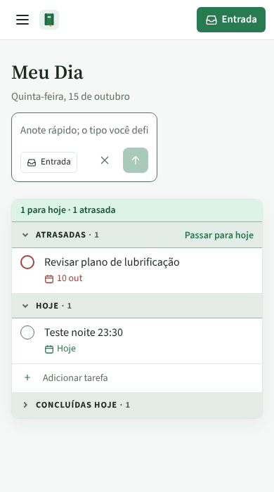
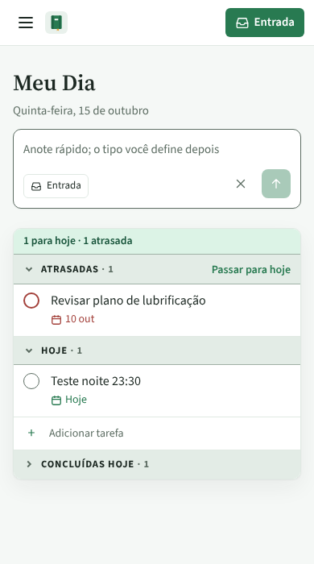
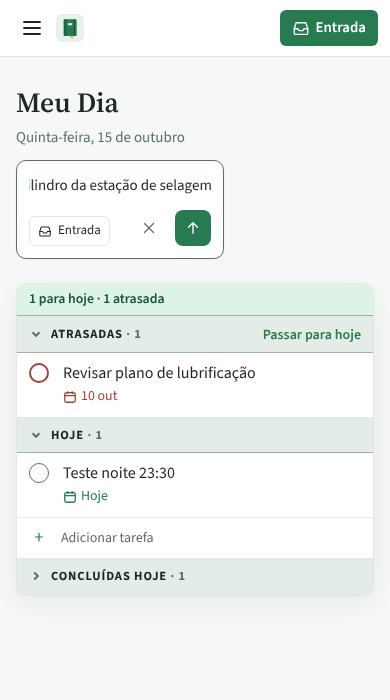
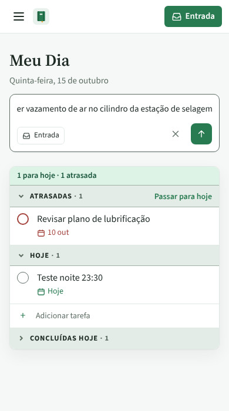
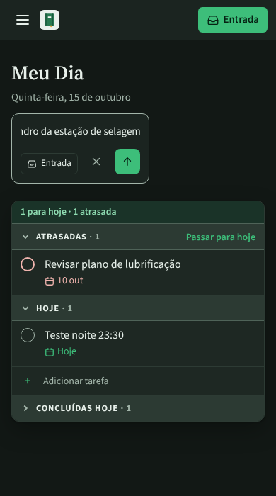
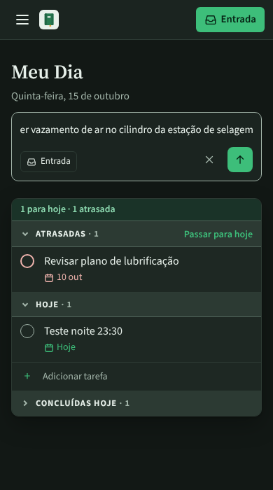
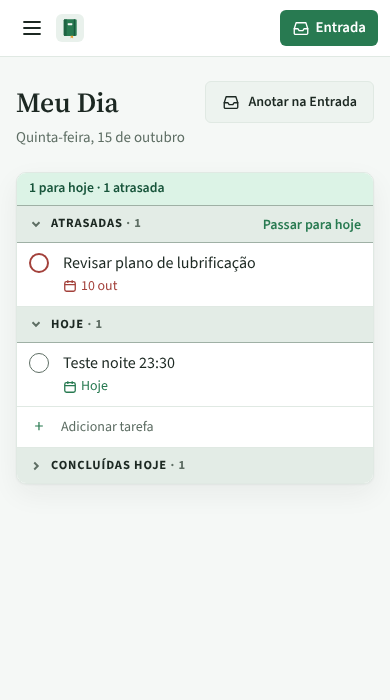
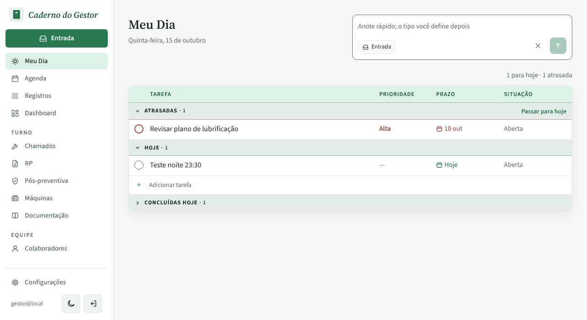

# PR #82: caixa de anotar do Meu Dia no celular

PR: https://github.com/LeonardoBrum0907/gestao-manutencao/pull/82

Meu Dia, tocando em "Anotar na Entrada" e digitando "Ver vazamento de ar no cilindro da estação de selagem".
Antes, no celular de 390 px, o campo tinha 182 px (169 no tema escuro) e cortava o texto de exemplo e o que se
digitava. Depois, o campo tem 332 px, a largura da tela menos as margens. No computador as imagens de antes e
depois são idênticas pixel a pixel.

| | Antes da correção | Depois da correção |
| --- | --- | --- |
| Celular, caixa aberta |  |  |
| Celular, texto digitado |  |  |
| Celular, tema escuro, texto digitado |  |  |
| Celular, botão fechado (não muda) |  |  |
| Computador, caixa aberta (não muda) |  |  |
