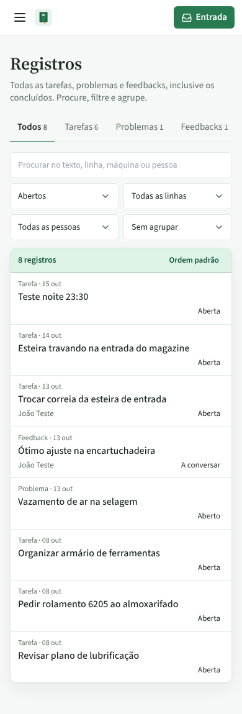
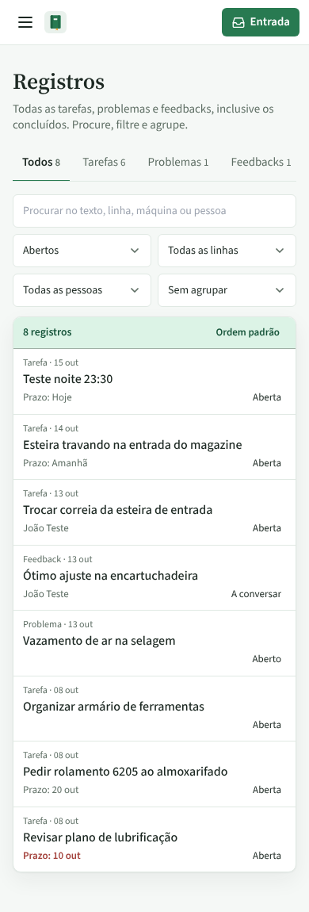
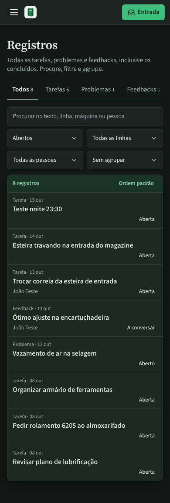
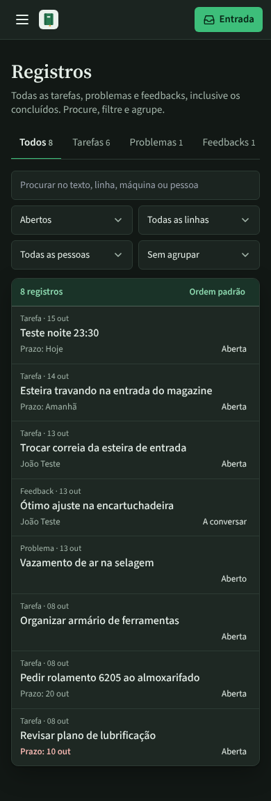
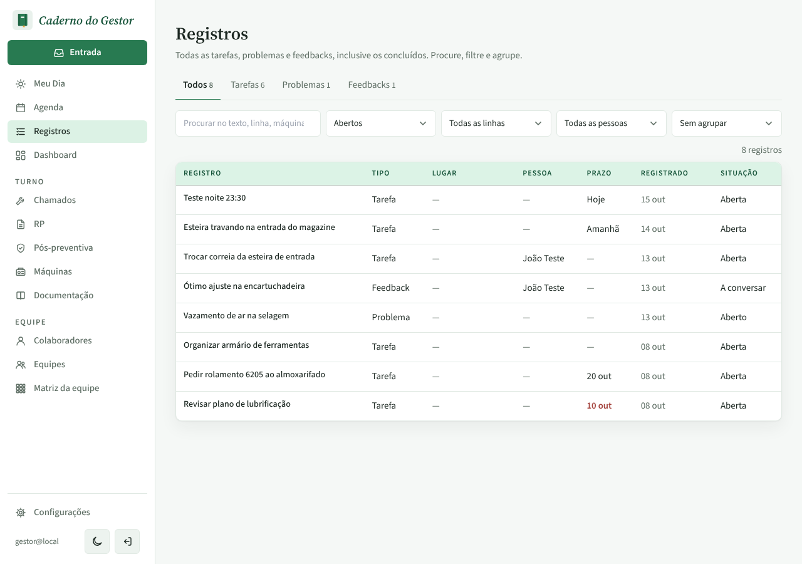

# PR #83: prazo das tarefas na lista de Registros no celular

PR: https://github.com/LeonardoBrum0907/gestao-manutencao/pull/83

Lista de Registros com data fixa em 15 out. No celular (390 px) a coluna Prazo some, e antes a linha mostrava só o
lugar ou a pessoa: "Revisar plano de lubrificação", atrasada desde 10 out, não dava sinal de atraso. Depois, a linha
mostra "Prazo: 10 out" ao lado do lugar, em vermelho e negrito quando passou do prazo. No computador as imagens de
antes e depois são idênticas pixel a pixel.

| | Antes da correção | Depois da correção |
| --- | --- | --- |
| Celular, tema claro |  |  |
| Celular, tema escuro |  |  |
| Computador (não muda) |  |  |
