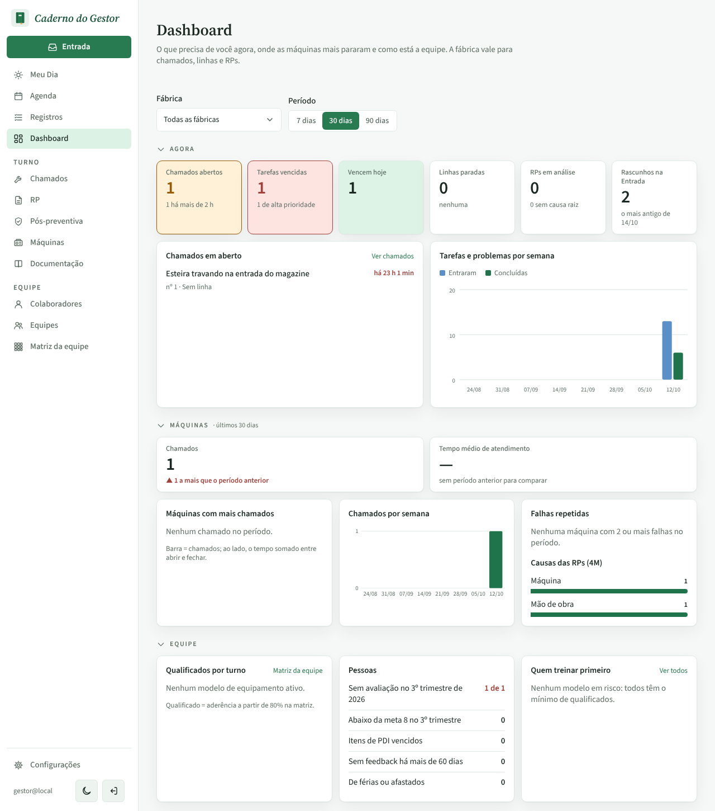
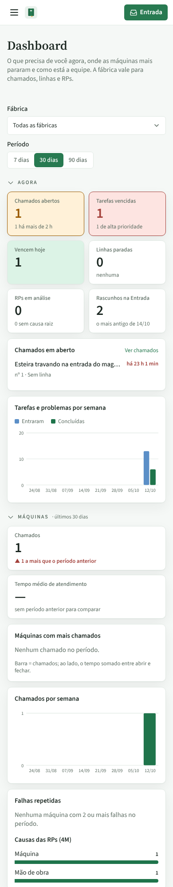
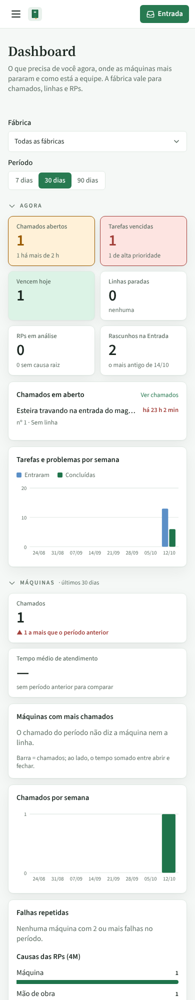

# PR #84: "Máquinas com mais chamados" sem chamado com máquina

PR: https://github.com/LeonardoBrum0907/gestao-manutencao/pull/84

Dashboard, período de 30 dias, com um chamado aberto ("Esteira travando na entrada do magazine") sem máquina e sem
linha. Antes, o cartão Chamados dizia 1 e, logo abaixo, "Máquinas com mais chamados" dizia "Nenhum chamado no
período.". Depois, o quadro diz "O chamado do período não diz a máquina nem a linha.". Sem chamado nenhum no período,
o texto continua "Nenhum chamado no período.". O resto da tela não muda.

| | Antes da correção | Depois da correção |
| --- | --- | --- |
| Computador |  |  |
| Celular |  |  |
