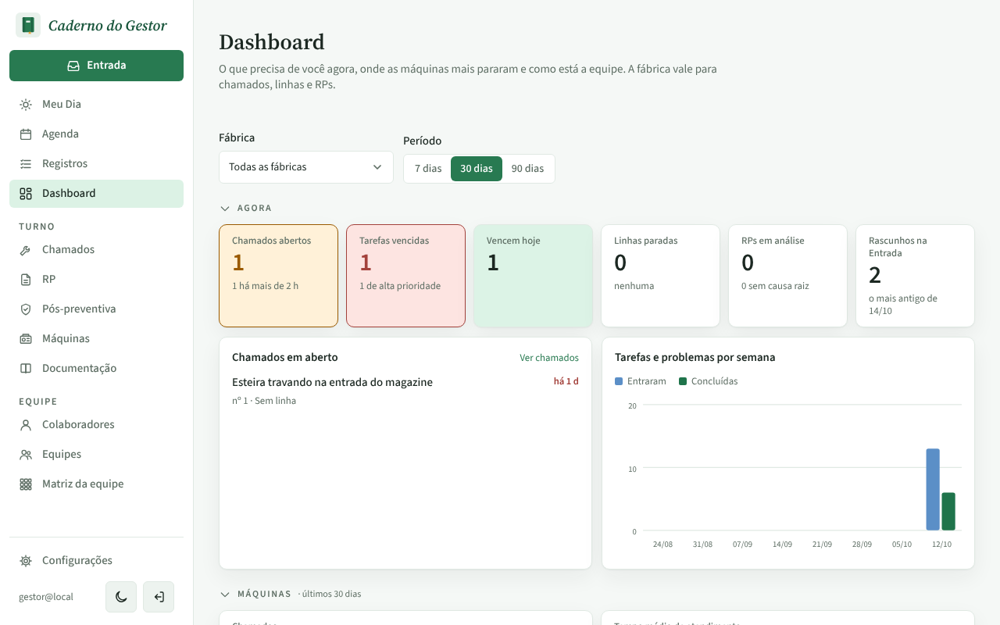
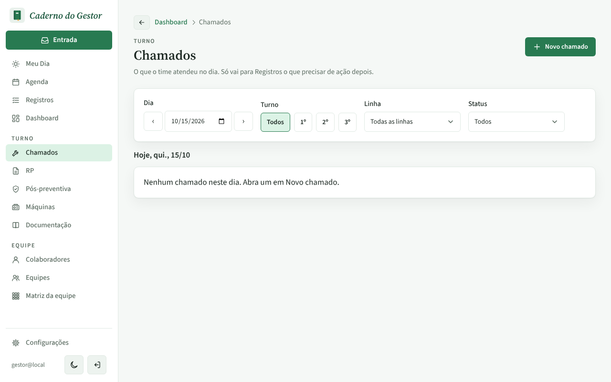
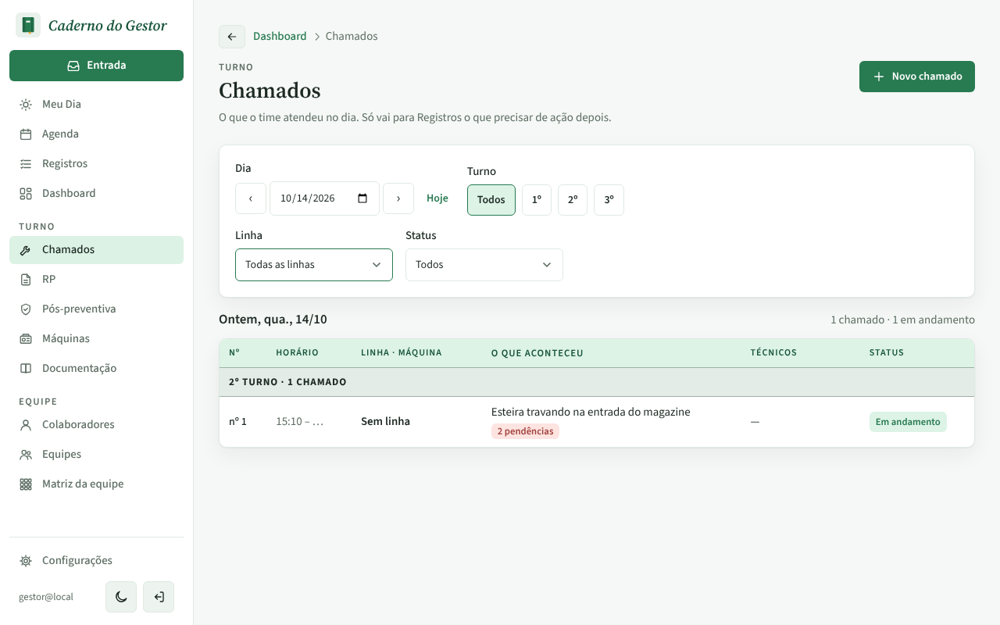
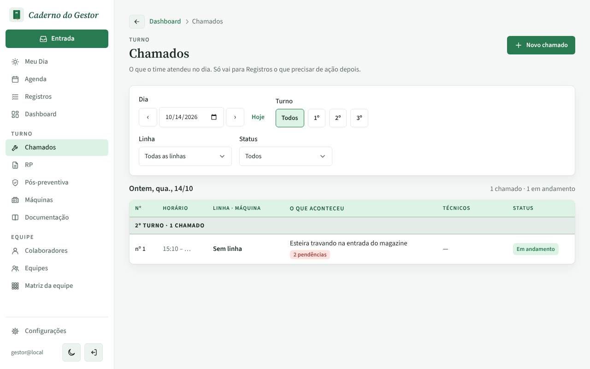
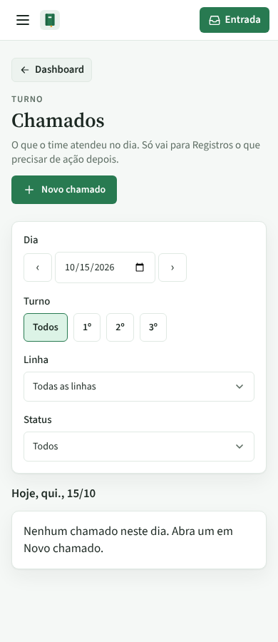
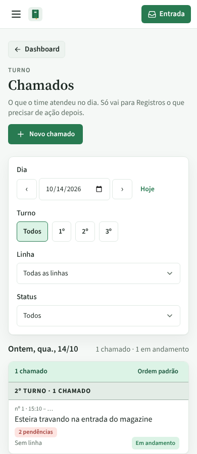

# PR #85: "Chamados abertos" do Dashboard leva ao dia do chamado aberto

PR: https://github.com/LeonardoBrum0907/gestao-manutencao/pull/85

Hoje é 15/10 e o único chamado em aberto ("Esteira travando na entrada do magazine") foi aberto ontem, 14/10. No
Dashboard, o cartão "Chamados abertos" mostra 1 e o quadro "Chamados em aberto" lista o chamado:

Antes, clicar no cartão ou em "Ver chamados" abria os chamados de hoje: "Nenhum chamado neste dia". Depois, os dois
abrem o dia do chamado aberto mais antigo (14/10), onde ele aparece. Sem chamado aberto, continuam abrindo hoje.

| | Antes da correção | Depois da correção |
| --- | --- | --- |
| Computador, clique em "Chamados abertos" |  |  |
| Computador, clique em "Ver chamados" |  |  |
| Celular, clique em "Chamados abertos" |  |  |
