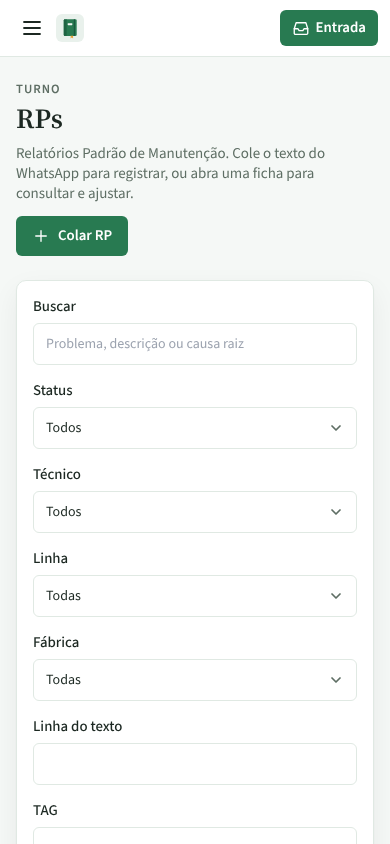
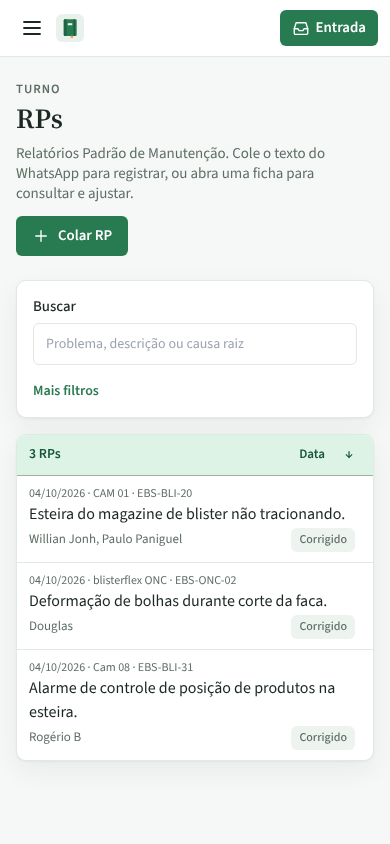
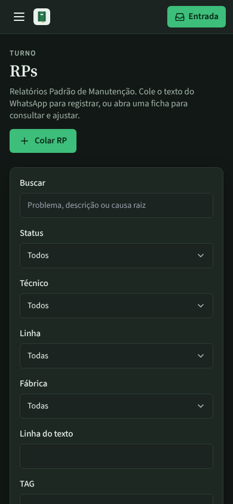
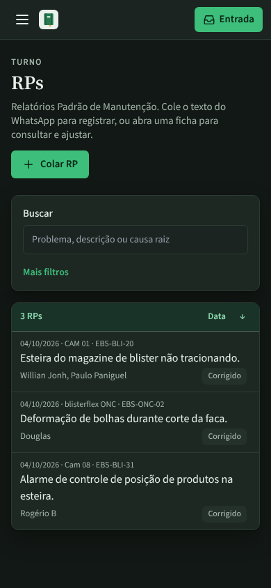
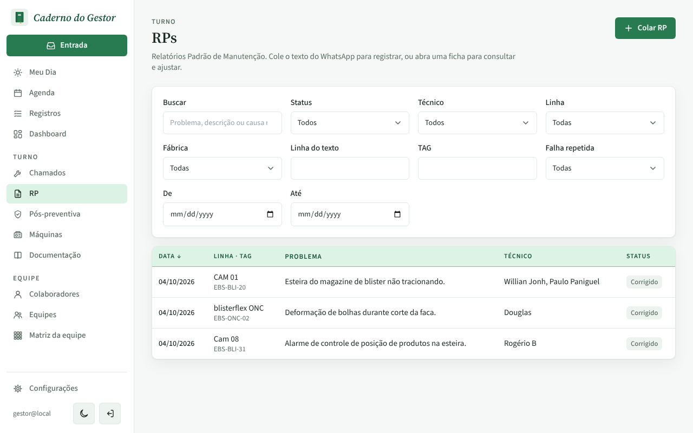
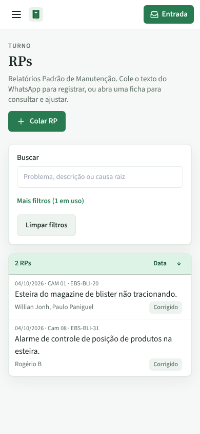
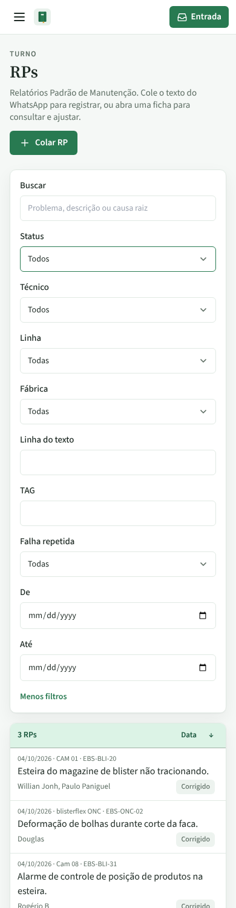

# PR #86: lista de RPs no celular sem rolar os filtros

PR: https://github.com/LeonardoBrum0907/gestao-manutencao/pull/86

Tela RPs com 3 RPs, celular de 390 × 844 px (a primeira tela). Antes, os 10 filtros empilhados ocupavam a tela
inteira e nenhum RP aparecia sem rolar. Depois, só Buscar fica à vista com o link "Mais filtros"; a lista começa
logo abaixo. Quando um filtro escondido está em uso, o link diz quantos ("Mais filtros (1 em uso)"). No computador
as imagens de antes e depois são idênticas pixel a pixel.

| | Antes da correção | Depois da correção |
| --- | --- | --- |
| Celular, tema claro |  |  |
| Celular, tema escuro |  |  |
| Computador (não muda) |  |  |

Depois, no celular:

| Com a TAG "BLI" filtrada | Depois de tocar em "Mais filtros" |
| --- | --- |
|  |  |
