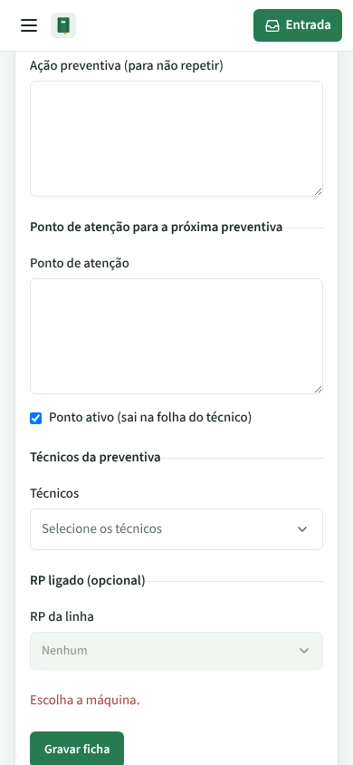
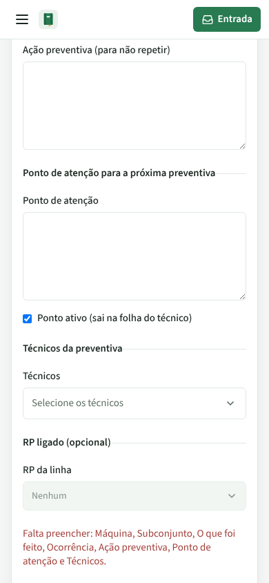
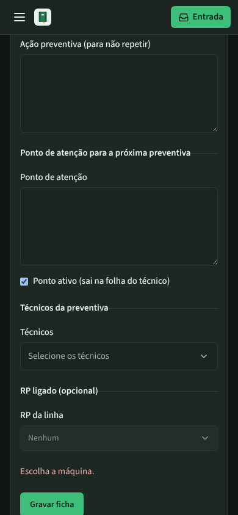
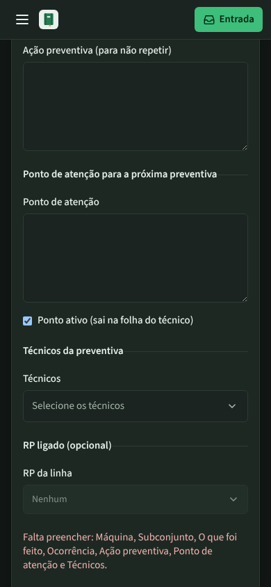
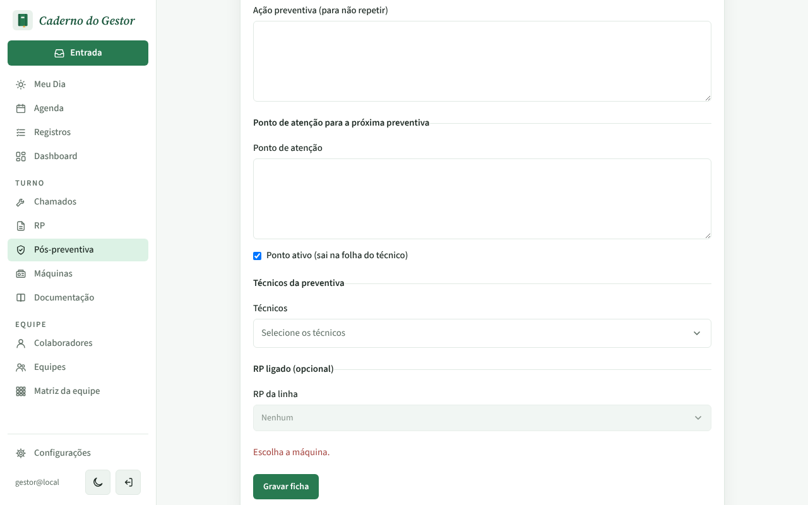
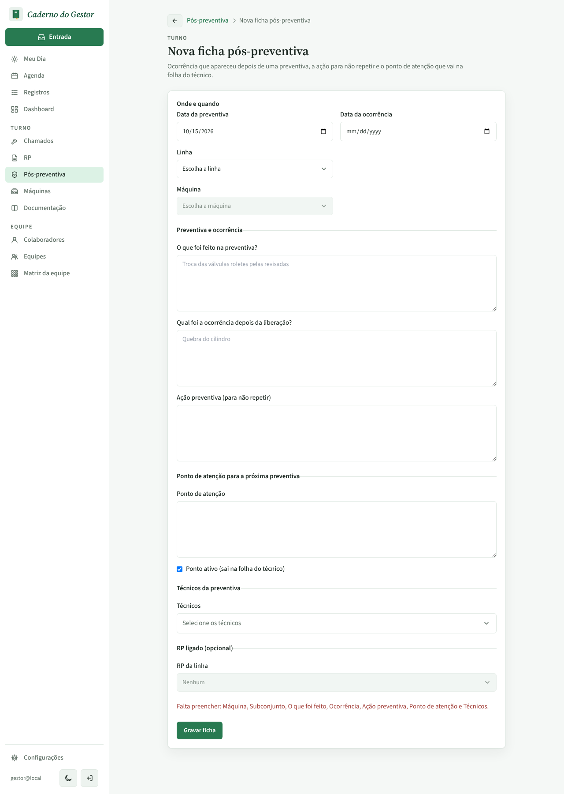

# PR #87 · Pós-preventiva: avisar todos os campos que faltam de uma vez

Ficha nova vazia, depois de clicar em **Gravar ficha**. A data da preventiva já vem preenchida com hoje.

| | Antes | Depois |
|---|---|---|
| Celular, claro |  |  |
| Celular, escuro |  |  |
| Computador, claro |  |  |
