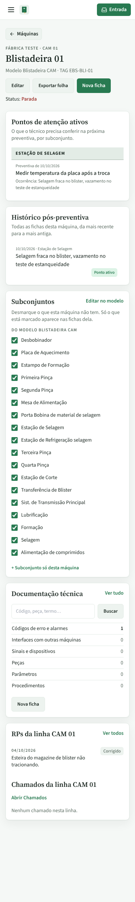
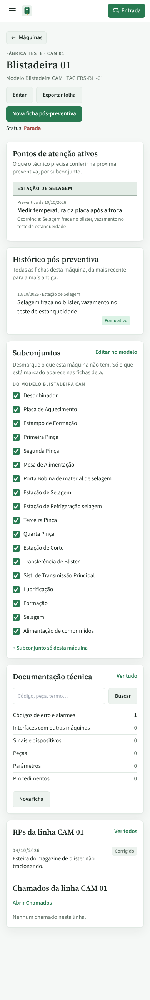
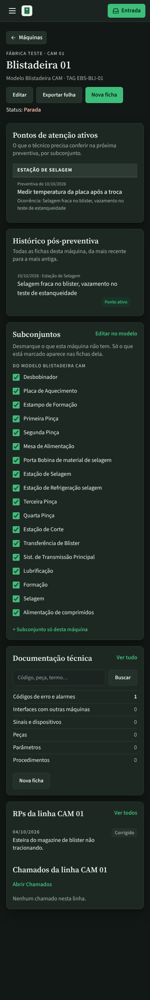
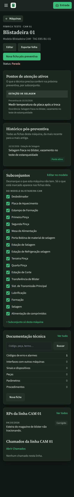
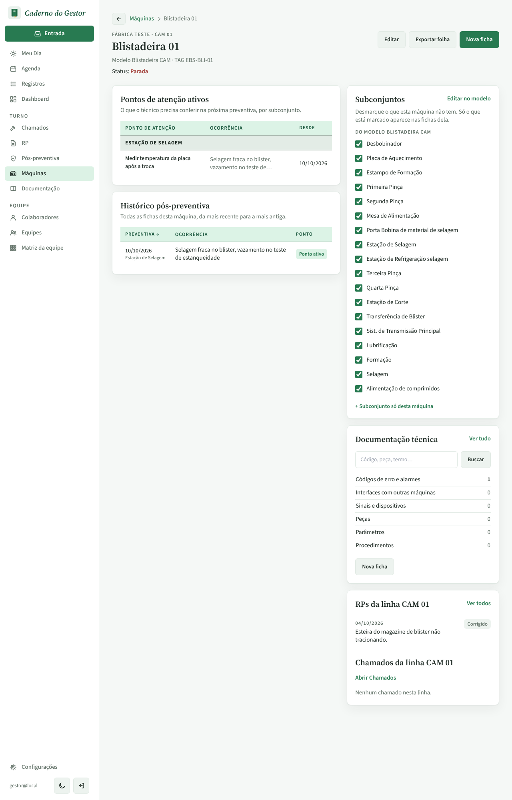
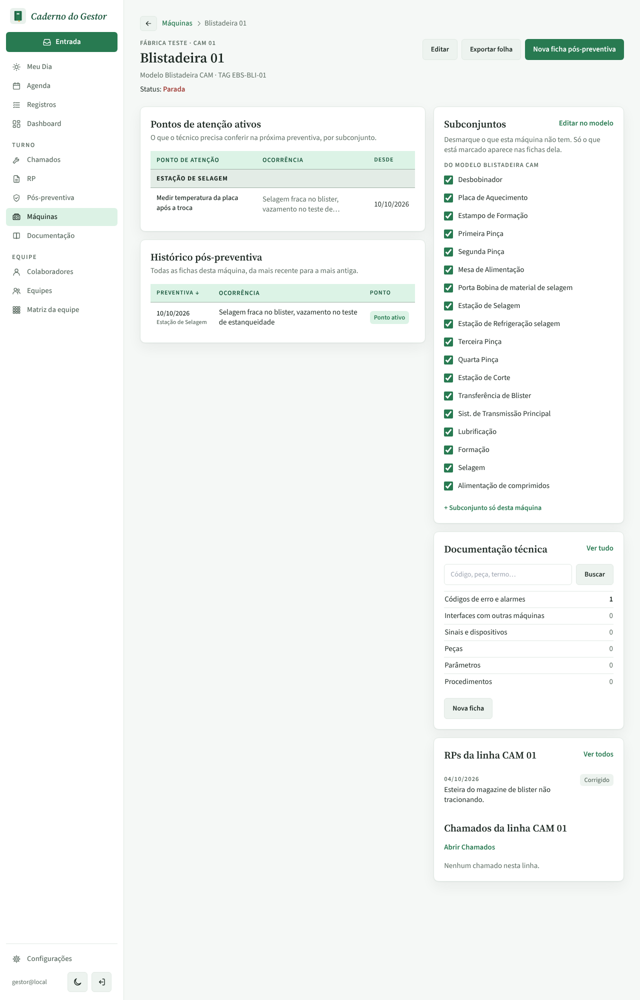

# PR #88 · Máquinas: botão do topo diz "Nova ficha pós-preventiva"

Tela da máquina (Blistadeira 01). Antes, o botão do topo e o do bloco Documentação técnica se chamavam os dois "Nova ficha".

| | Antes | Depois |
|---|---|---|
| Celular, claro |  |  |
| Celular, escuro |  |  |
| Computador, claro |  |  |
