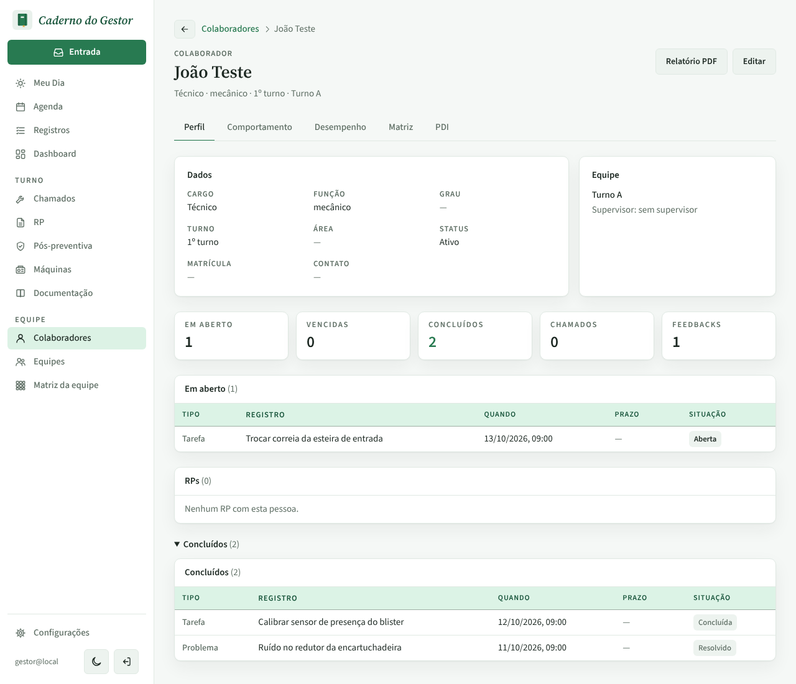
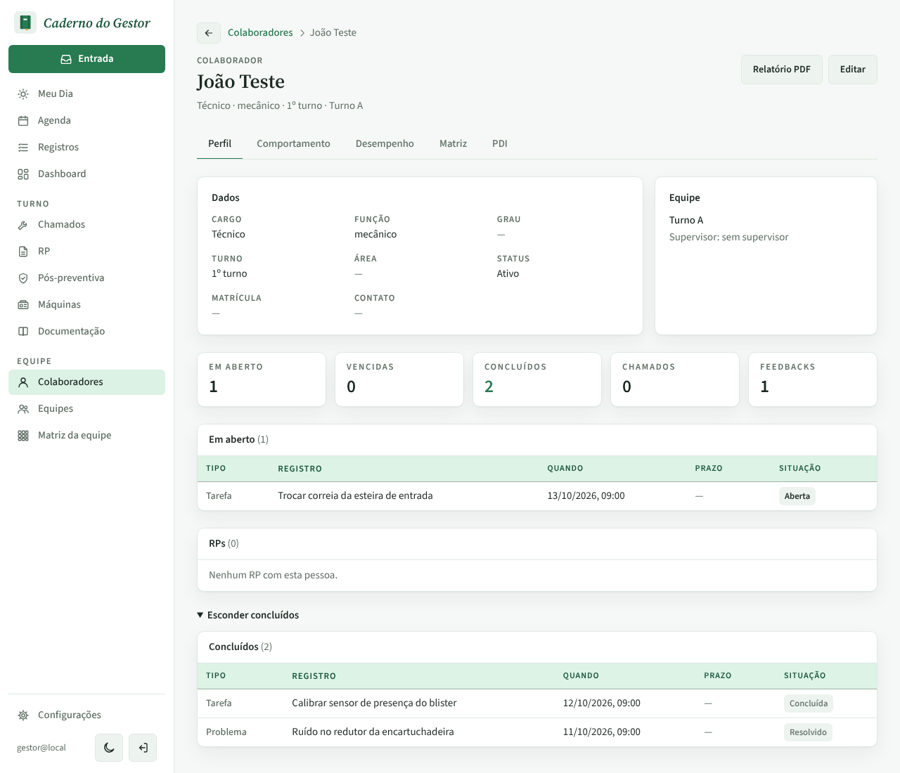
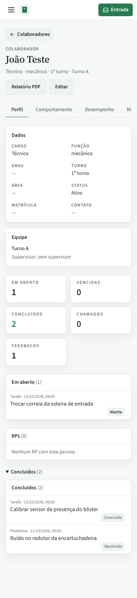
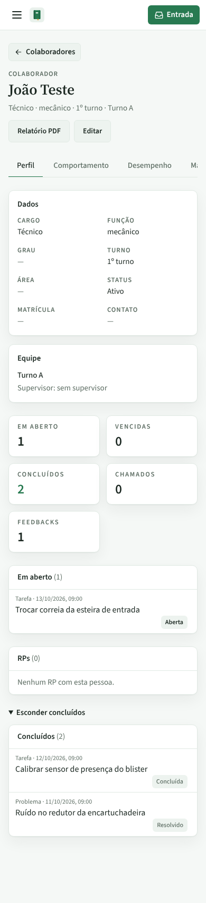
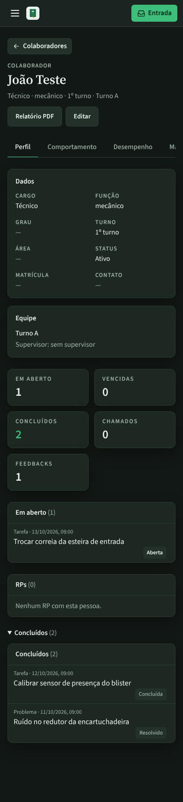
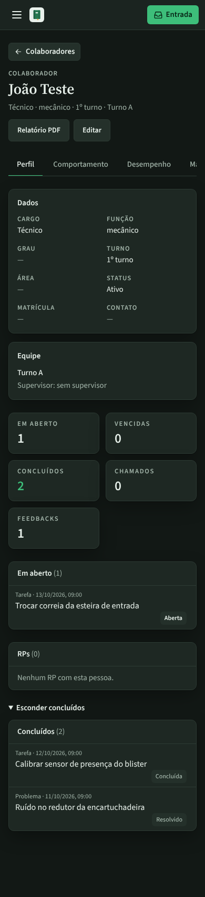
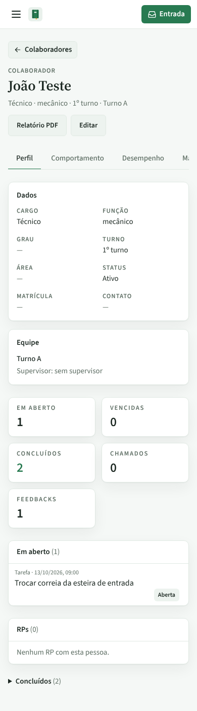
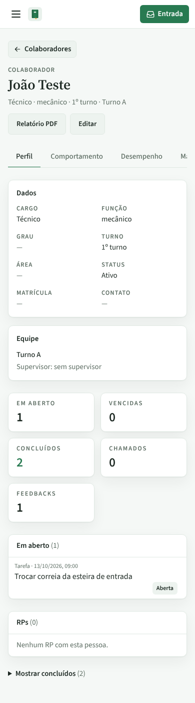

# PR #90 · Colaboradores: ficha não repete "Concluídos (n)" ao abrir a seção

Ficha do colaborador (João Teste), aba Perfil, no fim da tela.

| | Antes | Depois |
|---|---|---|
| Computador, claro, aberto |  |  |
| Celular, claro, aberto |  |  |
| Celular, escuro, aberto |  |  |
| Celular, claro, fechado |  |  |
