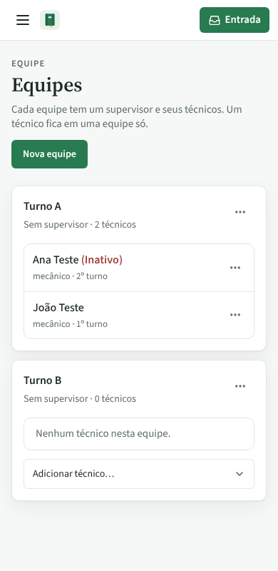
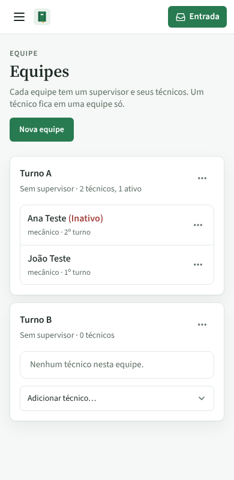
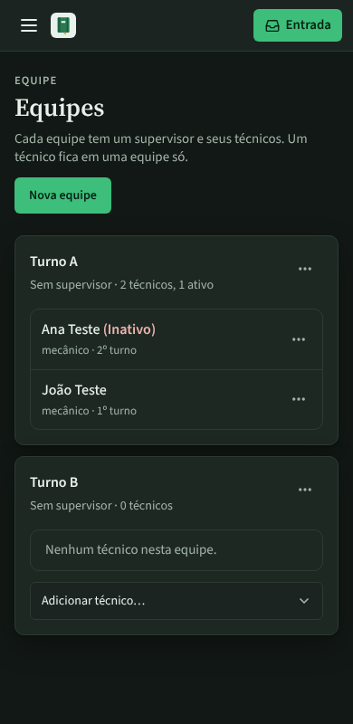
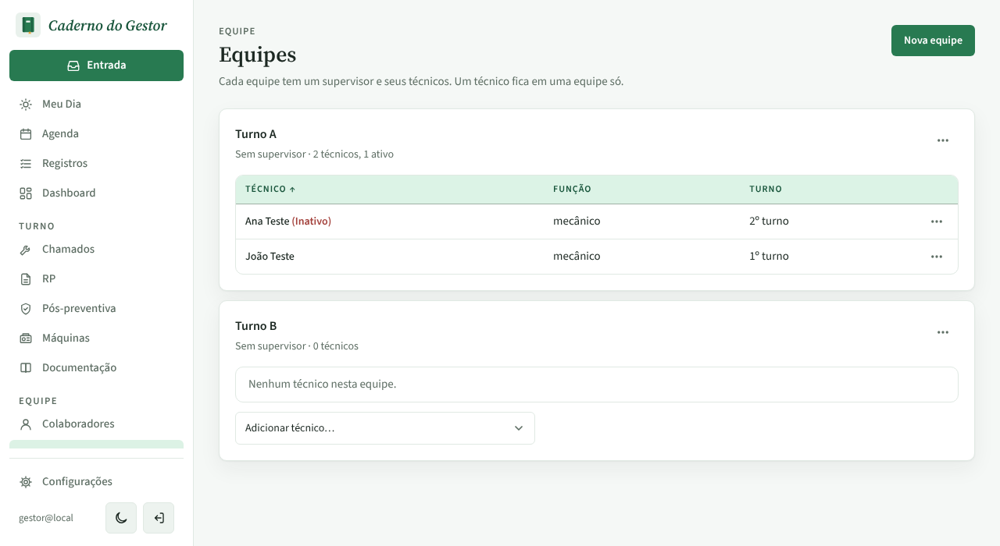

# PR #91 · Equipes: cartão da equipe diz quantos técnicos estão ativos

Tela Equipes. Turno A tem Ana Teste (inativa) e João Teste (ativo). Veja a linha embaixo do nome da equipe.

| | Antes | Depois |
|---|---|---|
| Celular, claro |  |  |
| Celular, escuro |  |  |
| Computador, claro |  |  |
