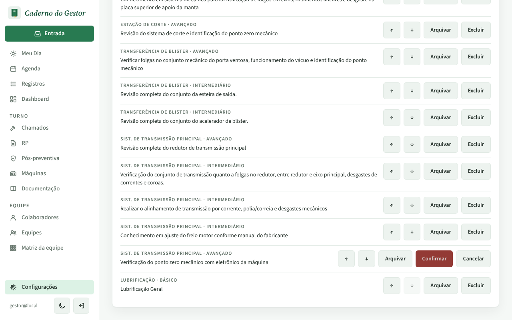
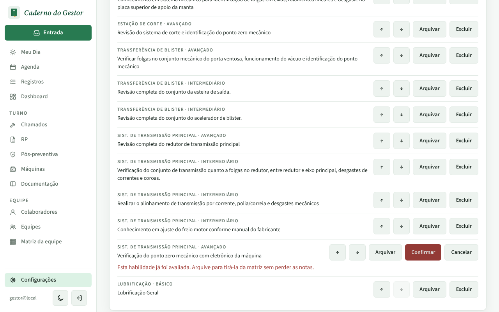
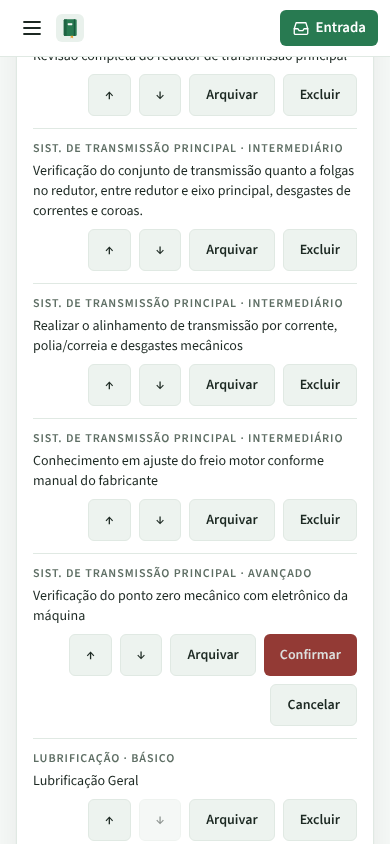
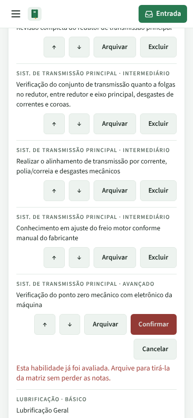

# PR #93: erro ao excluir habilidade aparece na própria linha

Configurações > Avaliação > Matriz de habilidades, equipamento Blistadeira CAM. A habilidade "Verificação do ponto zero mecânico com eletrônico da máquina" (36ª de 37) já tem nota; clicamos em Excluir e Confirmar.

| | Antes | Depois |
|---|---|---|
| Computador |  |  |
| Celular |  |  |

Antes, o aviso ficava no topo da lista: 1.889 px acima da tela no computador e 4.179 px no celular. Depois, ele aparece logo abaixo da habilidade.
