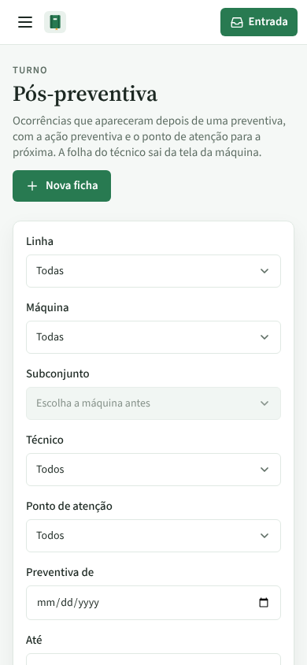
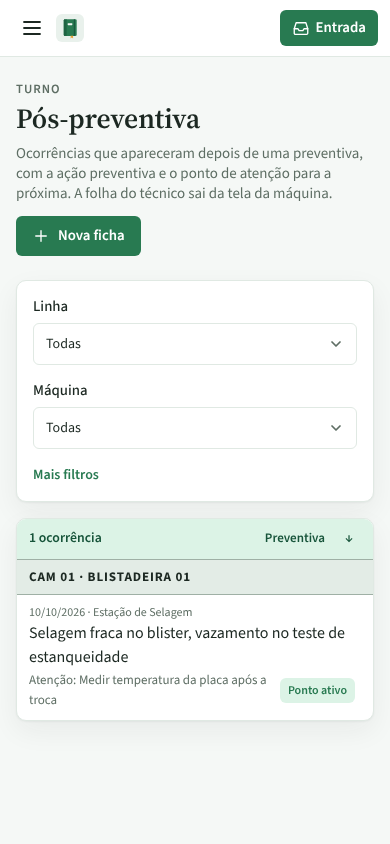
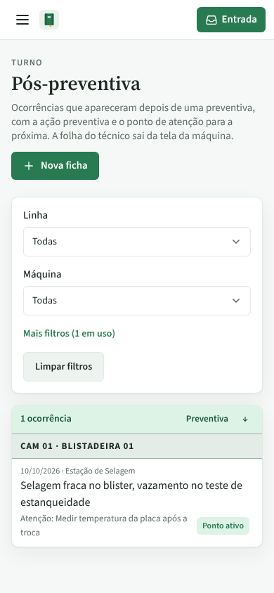

# PR #94: no celular, a lista de Pós-preventiva aparece sem rolar

Lista de Pós-preventiva no celular (390 × 844), primeira tela.

| Antes | Depois (fechado) | Depois (Mais filtros aberto) | Depois (com filtro escondido em uso) |
|---|---|---|---|
|  |  |  |  |

Antes, os 7 filtros ocupavam a primeira tela inteira e a ficha não aparecia. Depois, ficam Linha e Máquina; os outros 5 abrem em "Mais filtros", que diz quantos estão em uso ("Mais filtros (1 em uso)" com `?active=true`).

No computador nada muda ([print](computador-sem-mudanca.png), idêntico pixel a pixel ao de antes).
