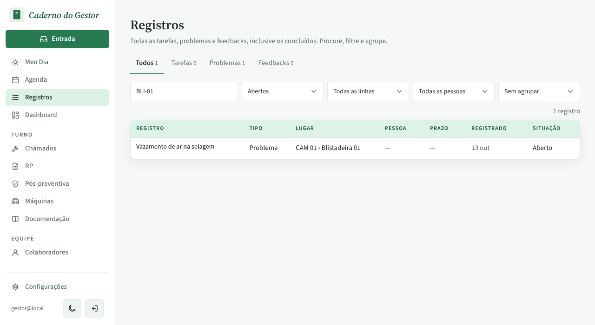

# PR #95: a busca de Registros acha pela TAG da máquina

Registros, busca "BLI-01". O problema "Vazamento de ar na selagem" está na Blistadeira 01 (CAM 01), cuja TAG é EBS-BLI-01.

| | Antes | Depois |
|---|---|---|
| Computador |  |  |
| Celular |  |  |

O campo de busca agora diz "Texto, lugar, TAG ou pessoa" e cabe inteiro em 1280 px ([print](campo-de-busca-pc.png)). O texto antigo, "Procurar no texto, linha, máquina ou pessoa", ficava cortado.
