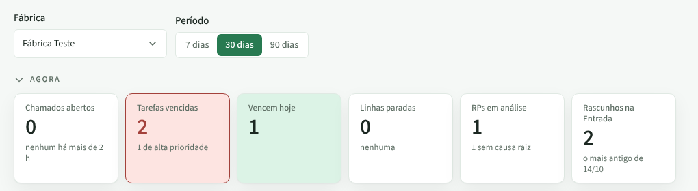
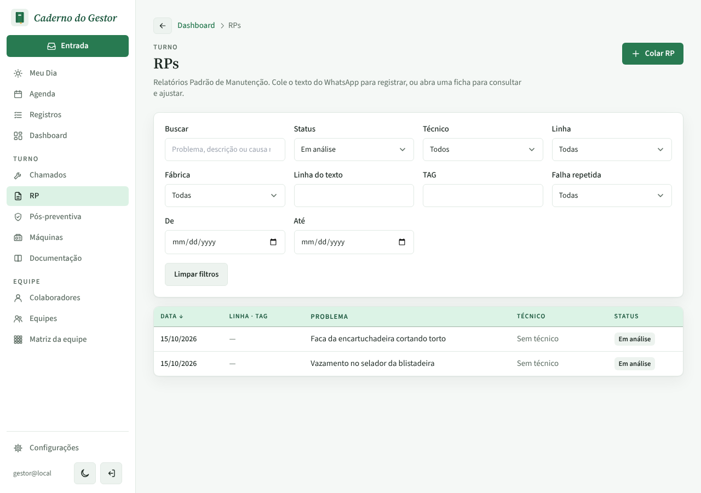
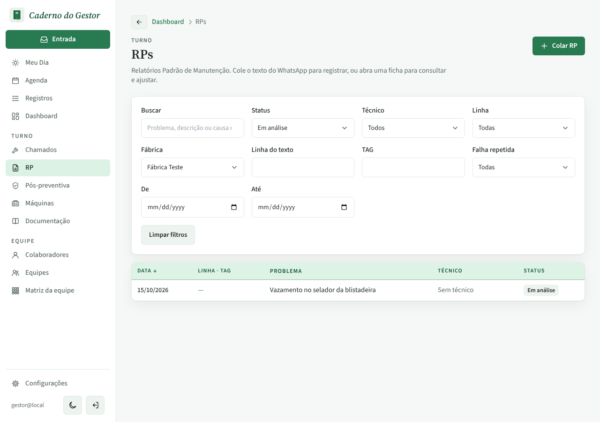

# PR #96 · Dashboard: "RPs em análise" na fábrica escolhida

Dados locais: duas fábricas, uma RP em análise em cada. Dashboard filtrado em "Fábrica Teste".

| | |
|---|---|
| Dashboard com "Fábrica Teste": o quadro conta 1 RP em análise |  |
| **Antes:** o clique abre a lista com Fábrica "Todas" e 2 RPs |  |
| **Depois:** a lista abre com Fábrica "Fábrica Teste" e 1 RP, igual ao quadro |  |
