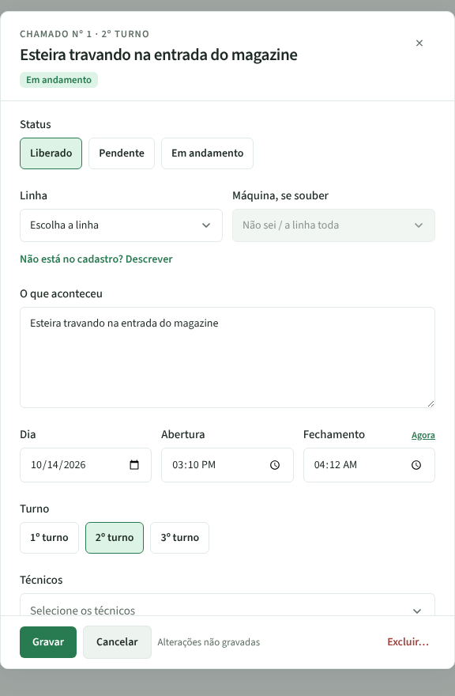
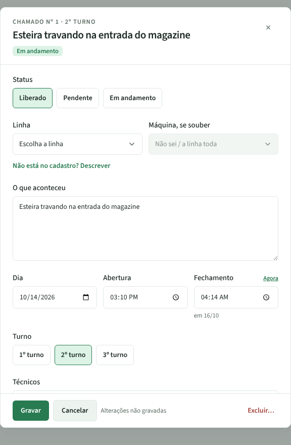
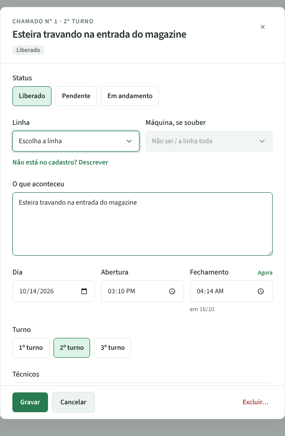

# PR #97 · Chamados: "Agora" no fechamento grava o dia de hoje

Chamado nº 1 aberto em 14/10 às 15:10, ainda em andamento. Em 16/10, de madrugada, marquei Liberado, cliquei em "Agora" no Fechamento e gravei.

| | Painel | Fechamento gravado (API) |
|---|---|---|
| **Antes** |  | `2026-10-15T07:12:00Z` = 15/10 04:12 (um dia a menos; atendimento de 13 h) |
| **Depois** |  | `2026-10-16T07:14:00Z` = 16/10 04:14 (atendimento de 37 h) |
| **Depois, ao reabrir** |  | o painel mostra "em 16/10" e gravar de novo mantém o dia |
